<p align="left"></p>

# 🏥 Detección de eventos adversos en epicrisis (MIMIC-IV) para su priorización con el Modelo GEMSES

Proyecto de investigación (Maestría en IA – UNI): un pipeline de PLN y aprendizaje automático que detecta, en la nota de alta hospitalaria, si la hospitalización tuvo un evento adverso. Es la base para priorizar esos eventos con la Matriz de Priorización del Modelo GEMSES.

Este repositorio forma parte del curso **Proyecto de Investigación II (MIA 403)**, dictado como **MIA-14 Trabajo de Investigación II**. Universidad Nacional de Ingeniería · Facultad de Ingeniería Industrial y de Sistemas · Unidad de Posgrado · Maestría en Inteligencia Artificial · ciclo 2026-2, sección B.

**Presentación del Sprint 1:** https://carlosperez100.github.io/mia14-trabajo-investigacion-ii-tesis-gemses-mimic/sprint1/

---

## 👥 Autores
- Carlos Pérez Pérez – [@carlosperez100](https://github.com/carlosperez100) · carlosperez100@gmail.com
- Docente: Dr. Ing. Glen Dario Rodríguez Rafael – [@GlenRodriguez](https://github.com/GlenRodriguez)

**Track:** A (venía de Proyecto I con un modelo entrenado, pero con un pipeline no reproducible; en el Sprint 1 se migró y se ordenó).

---

## 📊 Dataset
| | MIMIC-IV-Note v2.2 (texto) | MIMIC-IV v3.1 (diagnósticos) |
|---|---|---|
| **Fuente** | [PhysioNet – MIMIC-IV-Note v2.2](https://physionet.org/content/mimic-iv-note/2.2/) (acceso con credencial y DUA) | [PhysioNet – MIMIC-IV v3.1](https://physionet.org/content/mimiciv/3.1/) (acceso con credencial y DUA) |
| **Archivo** | `note/discharge.csv.gz` (1 139.2 MB) | `hosp/diagnoses_icd.csv.gz` (33.6 MB) |
| **Registros** | 331 793 epicrisis de 145 914 pacientes | 545 497 hospitalizaciones con diagnóstico |
| **Variables usadas** | `note_id`, `subject_id`, `hadm_id`, `text` | `hadm_id`, `icd_code`, `icd_version` |
| **Versión usada** | archivo del 11/05/2026 | archivo del 14/05/2026 |
| **Hash (SHA-256)** | `27bc552edaf81c2af322040cb7e8eb36417173b23c79405bb92fcf73bef2dbc5` | `47665a41b2a3ad990d6f314062d5bd6d29d467b0fd402dd94662044ec8b073d2` |

- **Variable objetivo `y` (0/1):** 1 si la hospitalización tiene un código CIE de semántica causal explícita de evento adverso (estrato A1, con equivalencias CIE-10-CM y familias CIE-9). Las tablas de etiquetas se registran con su hash en [`data/bitacora_datos.csv`](data/bitacora_datos.csv).
- **Corpus de trabajo:** 70 000 epicrisis (37 692 positivas) emparejadas por época de codificación. Partición por paciente: 55 915 de entrenamiento y 14 085 de test, con 0 pacientes compartidos.
- **Prevalencia real del evento en MIMIC-IV:** 20.12 % de las 545 497 hospitalizaciones con diagnóstico (109 775) y 27.59 % de las 331 604 que tienen epicrisis, que son las que el modelo puede leer (ver el EDA, punto 4.1).
- **Ética:** MIMIC está bajo el DUA de PhysioNet; no se redistribuye y no se publica texto clínico. Todo archivo de datos está excluido por `.gitignore`.

---

## 🗂️ Estructura del repositorio
```
data/
 ├── catalogos/               # catálogo de los 231 eventos del Anexo 02, tabla de la etiqueta y equivalencia validada con los eventos oficiales
 ├── raw/                     # vacío en git: MIMIC se lee desde la ruta del .env (DUA)
 ├── interim/                 # etiquetas copiadas y época CIE (salida de la ingesta)
 ├── processed/               # dataset.parquet, splits.csv y modelos (fuera de git)
 └── bitacora_datos.csv       # versionado de datos: fuente, fecha, SHA-256 y tamaño
notebooks/
 ├── 01_EDA_sprint1.ipynb     # primera versión del EDA (semana 3)
 ├── 02_EDA_semana4.ipynb     # EDA desplegada (src/eda.py) y, en la sección 7, el feature engineering (src/experimentos_fe.py)
 ├── 03_sprint2_semana6_variantes_datos.ipynb   # variantes de los datos y diagnósticos (semana 6)
 ├── 04_sprint3_semana7_hiperparametros.ipynb   # búsqueda de hiperparámetros, aleatoria y bayesiana (semana 7)
 └── 05_sprint3_semana7_importancia_variables.ipynb   # importancia de variables del modelo vigente (semana 7)
src/
 ├── run_pipeline.py          # orquestador: ingesta → preprocesado → eda → baseline → features
 ├── ingesta.py               # script de ingesta (idempotente, con hash)
 ├── preprocesado.py          # limpieza, emparejamiento y partición por paciente
 ├── eda.py                   # EDA reproducible con log automático y figuras (semana 4)
 ├── eda_variables.py         # EDA de las variables de la hospitalización y de los eventos del Anexo 02
 ├── eda_texto.py             # EDA del contenido del texto: secciones y vocabulario
 ├── baseline.py              # Dummy + regresión logística (+ referencia de la tesis)
 ├── reporte_baseline.py      # escribe logs/metrics_baseline.txt y las matrices de confusión
 ├── variables_dominio.py     # 18 variables de paciente, servicio, hospitalización y atención (semana 5)
 ├── features.py              # bloques de atributos A, B y C y configuraciones de la ablación (semana 5)
 ├── experimentos_fe.py       # validación cruzada por paciente, test, figura y metrics_fe.txt (semana 5)
 ├── variantes_datos.py       # marcas de etiqueta dudosa y variantes D0, D1 y D2 (semana 6)
 ├── experimentos_datos.py    # variantes de los datos y diagnósticos del modelo (semana 6); figuras en figuras_datos.py
 ├── experimentos_hp.py       # búsqueda de hiperparámetros aleatoria y bayesiana, confirmación y test (semana 7); figuras en figuras_hp.py
 ├── importancia_variables.py # importancia por permutación de bloques y variables, y coeficientes de términos filtrados (semana 7); figuras en figuras_imp.py
 └── utils.py                 # configuración, logging y hash
config/config.yaml            # semilla, split e hiperparámetros
logs/                         # logs por etapa, metrics_baseline.txt, metrics_eda.txt, metrics_fe.txt, metrics_datos.txt, metrics_hp.txt y metrics_importancia.txt
reportes/                     # resultados en JSON y CSV, y figuras
slides/                       # presentación de resultados del sprint
entregables/                  # entregables por semana (diseño del pipeline de la semana 2, matrices de consistencia de las semanas 3 y 7, roadmap y guion de la demo)
docs/                         # GitHub Pages
README.md
requirements.txt
.env.example
.gitignore
```

---

## ⚙️ Requisitos
- Python 3.13. Probado en Windows 11 con 15.6 GB de RAM (el corpus se limita a 70 000 notas por memoria; ver `n_max` en `config/config.yaml`).
- Credencial PhysioNet con acceso a MIMIC-IV v3.1 y MIMIC-IV-Note v2.2.

```bash
pip install -r requirements.txt
cp .env.example .env     # completar MIMIC_DIR, MIMIC_NOTE_DIR y ETIQUETAS_DIR
```

---

## 🚀 Cómo ejecutar el pipeline
Todo de una vez (unos 45 min en CPU):
```bash
python src/run_pipeline.py
```
O etapa por etapa:

1. **Ingesta de datos**
   ```bash
   python src/ingesta.py
   ```
   - Verifica las fuentes, calcula SHA-256 y escribe `data/bitacora_datos.csv`. La segunda ejecución no repite nada.

2. **Preprocesamiento**
   ```bash
   python src/preprocesado.py
   ```
   - Arma positivos y negativos emparejados por época, recupera el texto, limpia y hace la partición por paciente (semilla 42).
   - Guarda en `data/processed/` y deja los conteos de cada paso en `logs/preprocesado_*.log`.

3. **EDA (análisis exploratorio de datos)**
   ```bash
   python src/eda.py
   ```
   - Calidad, variables de la hospitalización (faltantes, numéricas, categóricas y modelo de contexto), texto (largo, secciones, vocabulario y fugas), variable objetivo (prevalencia real, drift y ruido de la etiqueta), eventos del Anexo 02 y correlaciones; escribe `logs/eda_*.log`, `logs/metrics_eda.txt`, `reportes/eda_resumen.json`, `reportes/eda_eventos_231.csv` y las figuras `reportes/figuras/fig_eda_*.png`. Tarda unos 4 minutos.
   - Además de la salida del preprocesado, lee de `MIMIC_DIR` las tablas `admissions`, `patients`, `diagnoses_icd`, `d_icd_diagnoses`, `drgcodes`, `services` e `icustays`, y de `MIMIC_NOTE_DIR` la lista de hospitalizaciones con epicrisis.

4. **Entrenamiento baseline (Dummy / regresión logística)**
   ```bash
   python src/baseline.py                  # incluye la referencia de la tesis (~33 min más)
   python src/baseline.py --sin-referencia # solo los baselines
   ```
   - Genera `logs/metrics_baseline.txt`, `reportes/baseline_resultados.json` y las figuras de `reportes/figuras/`.

5. **Feature engineering (semana 5)**
   ```bash
   python src/experimentos_fe.py           # o: python src/run_pipeline.py --desde features
   ```
   - Calcula las variables de dominio (la primera vez lee `admissions`, `services`, `transfers`, `icustays`, `prescriptions` y `microbiologyevents`; unos 2 minutos, luego queda en caché), corre la ablación A, A+B, A+C y A+B+C con validación cruzada por paciente y mide cada configuración una vez en test.
   - Escribe `logs/metrics_fe.txt`, `reportes/fe_resultados.json`, `reportes/fe_folds.csv` y `reportes/figuras/fig_fe_pr.png`. Tarda unas 2 horas en CPU.

---

## 📈 Resultados (Semana 3, ejecución del 30/09/2026)
- **EDA inicial** en `notebooks/01_EDA_sprint1.ipynb`, con tres decisiones accionables para el Sprint 2.
- **Métrica central: PR-AUC**, junto con F1 de la clase positiva y Recall. El dummy que siempre dice «sí» obtiene F1 = 0.698, porque el test tiene 53.7 % de positivas; por eso el F1 solo no basta.

| Modelo (test) | F1 (+) | Recall | PR-AUC | ROC-AUC |
|---|---|---|---|---|
| Dummy (más frecuente) | 0.698 | 1.000 | 0.537 | 0.500 |
| Dummy (estratificado) | 0.550 | 0.555 | 0.541 | 0.510 |
| **Regresión logística TF-IDF** | **0.791** | **0.771** | **0.879** | **0.864** |
| Referencia: modelo de la tesis (LinearSVC) | 0.778 | 0.762 | 0.861 | 0.843 |

- **Reproducibilidad:** el pipeline vuelve a obtener el modelo de la tesis (sensibilidad 0.7623, especificidad 0.7699, ROC-AUC 0.8426) con diferencia 0.0000.
- **Logs de resultados:** [`logs/metrics_baseline.txt`](logs/metrics_baseline.txt).
- **Trazabilidad:** cada cifra de esta sección y de la presentación tiene su fuente en [`reportes/TRAZABILIDAD_SPRINT1.md`](reportes/TRAZABILIDAD_SPRINT1.md); las del EDA de la semana 4 salen de [`reportes/eda_resumen.json`](reportes/eda_resumen.json).
- **Gráficos:** [curvas ROC y precisión-recall](reportes/figuras/fig_baseline_roc_pr.png) · [matrices de confusión](reportes/figuras/fig_matrices_confusion.png).
- **Slides de resultados:** [`slides/`](slides/) y la [presentación en línea](https://carlosperez100.github.io/mia14-trabajo-investigacion-ii-tesis-gemses-mimic/sprint1/).

---

## 🔎 EDA reproducible (Semana 4 · rama `sprint1-eda`)
Entregable «Github con el EDA». El análisis se ejecuta con un solo comando y deja registrado cada paso:

```bash
python src/eda.py
```

Lee el corpus que deja el preprocesado (70 000 epicrisis de 48 669 pacientes, partición por paciente con semilla 42) y lo analiza en cuatro frentes: las **variables de cada hospitalización** (21 variables: 19 tomadas de seis tablas de MIMIC-IV y 2 de la propia nota), el **texto de la epicrisis**, la **variable objetivo** (cuánto evento hay en realidad y qué tan limpia es la etiqueta) y los **231 eventos del Anexo 02**. Termina en tres decisiones para el siguiente sprint.

En cada corrida escribe un log con hora (`logs/eda_*.log`), el resumen [`logs/metrics_eda.txt`](logs/metrics_eda.txt), todas las cifras en [`reportes/eda_resumen.json`](reportes/eda_resumen.json), una fila por evento del catálogo en [`reportes/eda_eventos_231.csv`](reportes/eda_eventos_231.csv) y las figuras de esta sección. Solo produce agregados: ningún texto clínico sale del equipo. Las cifras son de la ejecución del 09/10/2026 y describen el corpus completo, train y test; lo que se ajusta con los datos (el vocabulario y el modelo de contexto) se ajusta solo con train.

EDA desplegada: [`notebooks/02_EDA_semana4.ipynb`](notebooks/02_EDA_semana4.ipynb), con las tablas y las figuras de esta corrida y, en su sección 7, el feature engineering de la semana 5. El cuaderno `01_EDA_sprint1.ipynb` conserva la primera versión, la de la semana 3.

### Flujo del análisis
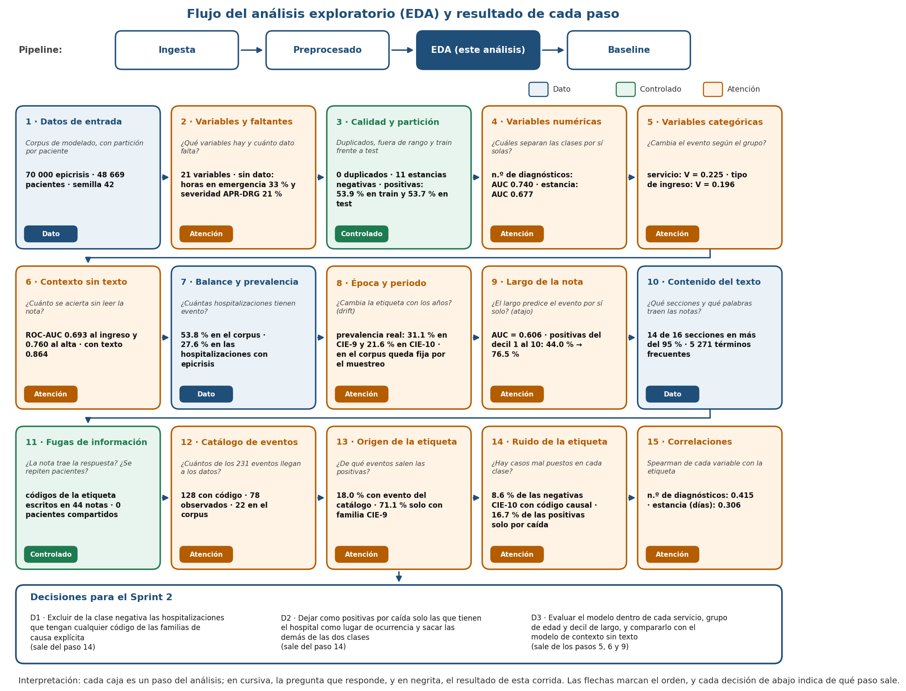

Cada caja corresponde a un paso del análisis, con la pregunta que responde y su resultado. Código de color: **azul**, dato descriptivo; **verde**, riesgo revisado y controlado; **ámbar**, hallazgo que pide una acción. La figura la genera el propio script con los resultados de la corrida.

### Lo que cambia respecto de la versión anterior
La primera versión de este EDA solo miraba el texto. Al incorporar las variables de la hospitalización y revisar la etiqueta, se corrigieron tres conclusiones de esa versión:

- **La «fuga de códigos CIE» no existe.** El patrón que se usó (letra, dos dígitos, punto y decimales) contaba sobre todo cadenas como `T98.2`, que por su valor son temperaturas y no códigos (punto 3.3).
- **La estabilidad en el tiempo era un efecto del muestreo.** En el corpus hay alrededor de 53.8 % de positivas en todos los periodos porque se toma una proporción fija de negativas por cada positiva. En la base, la proporción real de eventos baja de 31.1 % a 21.6 % al pasar de CIE-9 a CIE-10 (punto 4.1).
- **La prevalencia real no es 20.1 %.** Ese valor divide entre todas las hospitalizaciones, tengan o no epicrisis. Entre las que tienen epicrisis, que son las que el modelo puede leer, es 27.6 %.

### 1 · Los datos: calidad, balance y partición
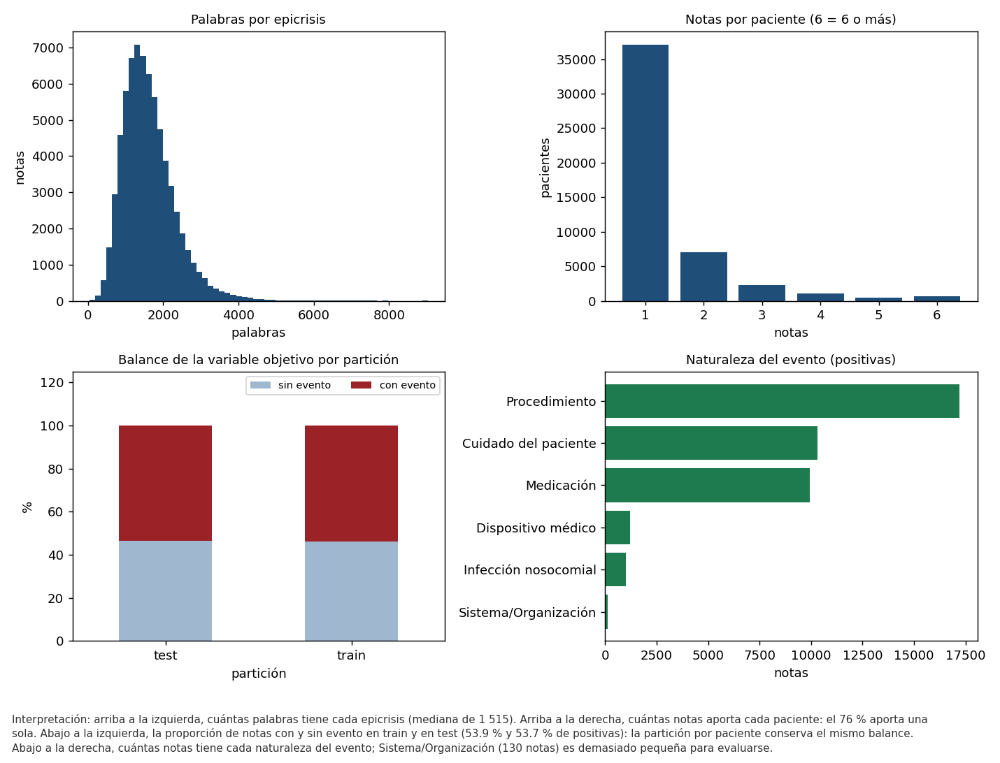

El corpus no tiene nulos en sus columnas ni duplicados de nota, hospitalización o texto. La epicrisis tiene una mediana de 9 932 caracteres y 1 515 palabras; 1 933 notas (2.8 %) son atípicas por largo y se conservan porque son notas reales. Cada paciente aporta 1.44 notas en promedio. Entre las variables de la hospitalización hay 11 estancias negativas (la hora de alta registrada es anterior a la de ingreso; 9 son de pacientes fallecidos).

Train y test se parecen, como se espera de una partición aleatoria por paciente:

| | Epicrisis | % con evento | Mediana de edad | Mediana de estancia (días) | Mediana del largo | % hombres | % con UCI | % en CIE-10 |
|---|---|---|---|---|---|---|---|---|
| Train | 55 915 | 53.9 | 64 | 3.88 | 9 915 | 49.3 | 21.7 | 28.6 |
| Test | 14 085 | 53.7 | 63 | 3.88 | 10 001 | 50.0 | 21.3 | 30.0 |

La única diferencia que conviene vigilar está en la época: en test, el 30.8 % de las positivas y el 29.2 % de las negativas son de CIE-10 (en train, 28.5 % y 28.9 %), y el AUC de la época sola es 0.508 en test.

### 2 · Las variables de cada hospitalización
Cada epicrisis se une por hospitalización con las tablas `admissions`, `patients`, `diagnoses_icd`, `drgcodes`, `services` e `icustays` de MIMIC-IV. Para cada variable se registra de dónde sale, en qué momento de la atención se conoce y para qué se puede usar: una variable que se conoce después del alta, o que sale de la misma codificación que la etiqueta, no puede ser predictor.

| Variable | Tipo | Tabla de MIMIC-IV | Se conoce en | Uso en el proyecto | % sin dato |
|---|---|---|---|---|---|
| Edad al ingreso | numérica | patients, admissions | ingreso | descripción y sesgo | 0.0 |
| Sexo | categórica | patients | ingreso | descripción y sesgo | 0.0 |
| Raza o etnia (agrupada) | categórica | admissions | ingreso | descripción y sesgo | 3.7 |
| Tipo de seguro | categórica | admissions | ingreso | descripción y sesgo | 1.1 |
| Idioma inglés | binaria | admissions | ingreso | descripción y sesgo | 0.2 |
| Estado civil | categórica | admissions | ingreso | descripción | 2.3 |
| Tipo de ingreso | categórica | admissions | ingreso | control | 0.0 |
| Servicio al ingreso | categórica | services | ingreso | control y evaluación por subgrupo | 0.0 |
| Horas en emergencia | numérica | admissions | ingreso | control | 33.2 |
| Periodo de atención (año aproximado) | categórica | patients, admissions | ingreso | drift temporal | 0.0 |
| Paso por UCI | binaria | icustays | estancia | control (puede ser consecuencia del evento) | 0.0 |
| Estancia hospitalaria (días) | numérica | admissions | alta | proxy de la dimensión Tiempo de GEMSES; no es predictor | 0.0 |
| Destino al alta | categórica | admissions | alta | descripción | 12.5 |
| Fallecimiento hospitalario | binaria | admissions | alta | desenlace; no es predictor | 0.0 |
| Alta contra indicación médica | binaria | admissions | alta | proxy de la dimensión Satisfacción de GEMSES | 12.5 |
| Reingreso dentro de 30 días | binaria | admissions | después del alta | proxy de la dimensión Satisfacción de GEMSES | 0.0 |
| Número de diagnósticos codificados | numérica | diagnoses_icd | codificación | contaminada por la etiqueta; no es predictor | 0.0 |
| Severidad APR-DRG (1 a 4) | numérica | drgcodes | codificación | insumo del proxy de la dimensión Costos de GEMSES (DRG); contaminada por la etiqueta | 21.2 |
| Largo de la epicrisis | numérica | nota de alta | alta | control del atajo por largo | 0.0 |
| Epicrisis del mismo paciente en el corpus | numérica | nota de alta | corpus | control | 0.0 |
| Época de codificación (CIE-9 o CIE-10) | categórica | diagnoses_icd | codificación | confusor | 0.0 |

#### 2.1 · Datos faltantes
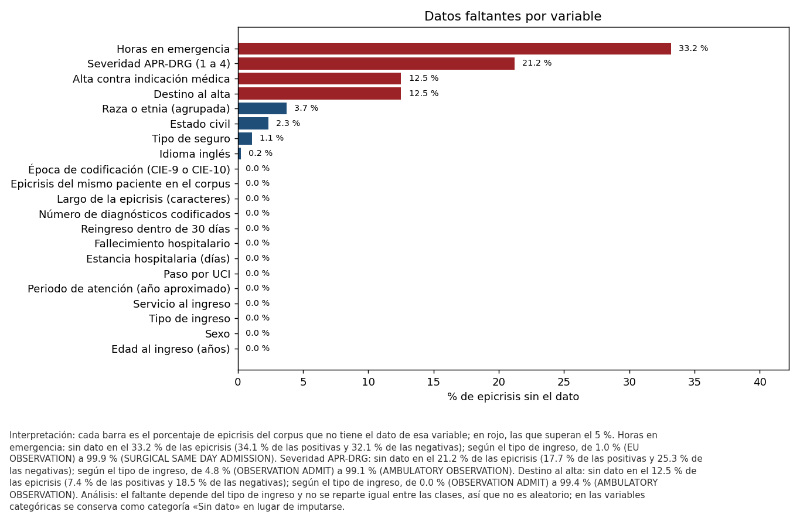

Cuatro variables superan el 5 % de faltantes: horas en emergencia (33.2 %), severidad APR-DRG (21.2 %), destino al alta y alta contra indicación médica (12.5 %; la segunda se deriva de la primera). En la raza, las respuestas «desconocida», «no se pudo obtener» y «el paciente no quiso responder» se cuentan como dato faltante (3.7 %).

El faltante depende del tipo de ingreso (con el código de MIMIC-IV). El destino al alta falta en el 96.8 % o más de tres tipos de ingreso en observación (`AMBULATORY OBSERVATION`, `EU OBSERVATION` y `DIRECT OBSERVATION`) y en el 0.2 % o menos del resto. Las horas en emergencia faltan en el 99.9 % de los ingresos `SURGICAL SAME DAY ADMISSION` y en el 4.2 % de los `EW EMER.`. Tampoco se reparte igual entre las clases: cuando falta el destino al alta, el 31.7 % de las epicrisis tiene evento; cuando no falta, el 57.0 %.

El faltante no es aleatorio y lleva información sobre el tipo de atención. Por eso no se imputa con un valor central: en las variables categóricas se conserva como una categoría más, «Sin dato», y así entra en todas las medidas de asociación.

#### 2.2 · Variables numéricas
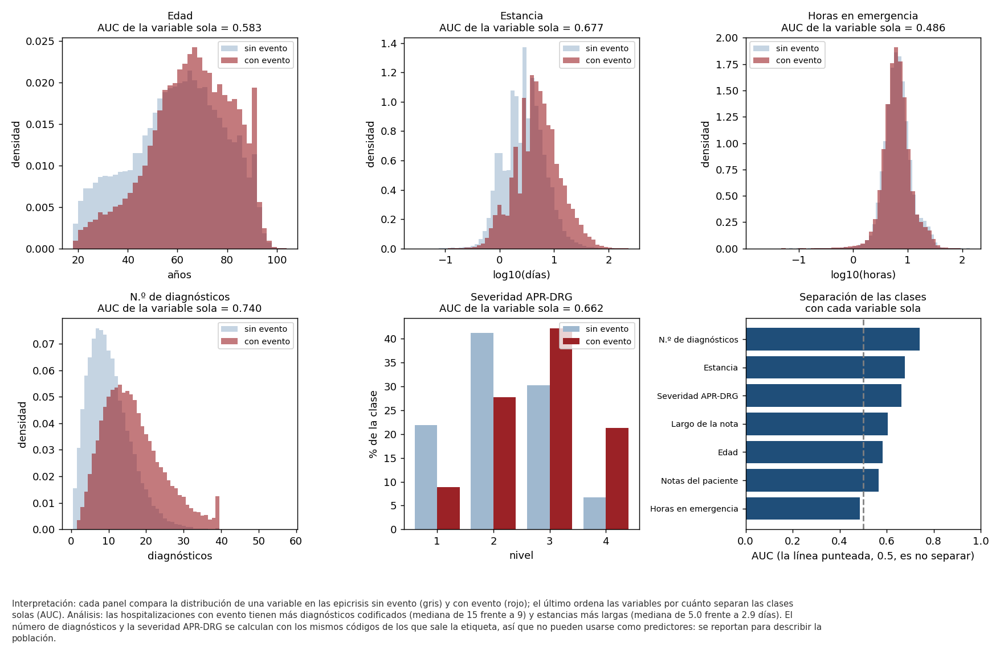

| Variable | Media | Desv. | Mín. | Q1 | Mediana | Q3 | Máx. | Atípicos (IQR) | Mediana sin evento | Mediana con evento | AUC sola |
|---|---|---|---|---|---|---|---|---|---|---|---|
| Edad (años) | 62.36 | 17.79 | 18 | 51 | 64 | 76 | 103 | 0.00 % | 61 | 66 | 0.583 |
| Estancia (días) | 6.14 | 8.12 | −0.95 | 1.99 | 3.88 | 6.98 | 230.69 | 8.11 % | 2.88 | 5.00 | 0.677 |
| Horas en emergencia | 7.67 | 5.58 | 0.00 | 4.58 | 6.33 | 8.85 | 139.33 | 7.15 % | 6.43 | 6.25 | 0.486 |
| N.º de diagnósticos | 13.59 | 7.63 | 1 | 8 | 12 | 18 | 57 | 2.11 % | 9 | 15 | 0.740 |
| Severidad APR-DRG | 2.52 | 0.92 | 1 | 2 | 3 | 3 | 4 | 0.00 % | 2 | 3 | 0.662 |
| Largo de la nota (caracteres) | 10 684 | 4 643 | 353 | 7 453 | 9 932 | 13 024 | 58 156 | 2.76 % | 9 185 | 10 717 | 0.606 |
| Epicrisis del mismo paciente | 2.32 | 2.40 | 1 | 1 | 1 | 3 | 27 | 5.55 % | 1 | 2 | 0.566 |

Los atípicos se cuentan con la regla de 1.5 veces el rango intercuartílico, y la última columna es el AUC que se obtiene usando solo esa variable (0.5 es no separar las clases). La última fila se calcula por nota, por eso su media (2.32) es mayor que las 1.44 notas por paciente del punto 1.

Las hospitalizaciones con evento tienen más diagnósticos codificados (mediana de 15 frente a 9), estancias más largas (5.0 frente a 2.9 días), más severidad y más edad (66 frente a 61 años). Las horas en emergencia no separan las clases. La edad máxima es 103 años, pero las edades más altas no son exactas: según la descripción de MIMIC-IV en PhysioNet, la base asigna 91 años a los pacientes que tenían más de 89 en su año de referencia.

El número de diagnósticos y la severidad APR-DRG son las variables que más separan, pero se calculan con los mismos códigos de los que sale la etiqueta: usarlas como predictores sería fuga. Se reportan para describir la población, y la estancia queda como proxy de la dimensión Tiempo de la matriz GEMSES.

#### 2.3 · Variables categóricas
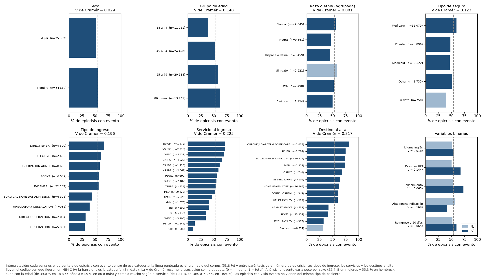
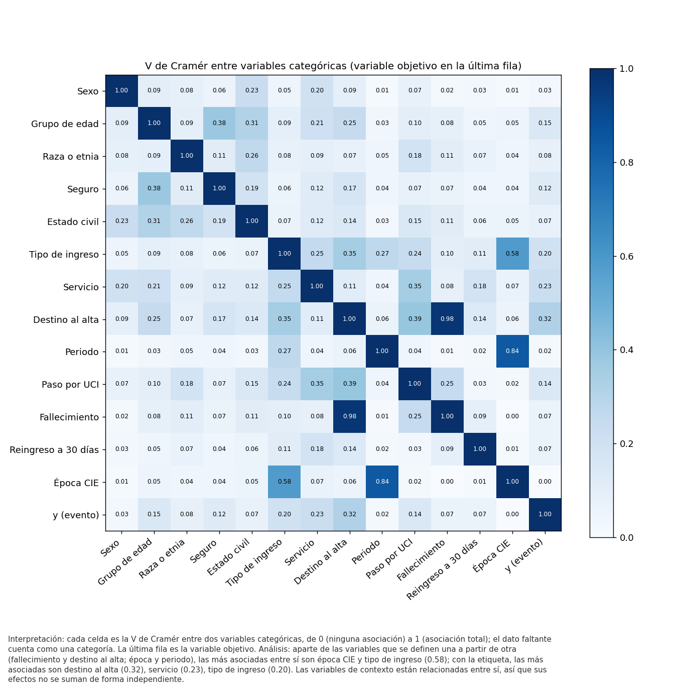

La primera figura da el porcentaje de epicrisis con evento en cada categoría y la V de Cramér de cada variable con la etiqueta (0 es ninguna asociación; 1, asociación total). Las categorías con menos de 50 casos se agrupan en «Otros». La segunda es la matriz de asociación entre las variables categóricas, con la variable objetivo en la última fila.

Las asociaciones más fuertes con la etiqueta son las del destino al alta (V = 0.317), el servicio (0.225), el tipo de ingreso (0.196), el grupo de edad (0.148) y el paso por UCI (0.144). La del alta contra indicación médica (0.169) viene de su categoría «Sin dato», que es la misma del destino al alta. Por servicio (con el código de MIMIC-IV), el evento va de 10.1 % en `OBS` y 13.2 % en `PSYCH` a 71.6 % en `VSURG` y 71.7 % en `TRAUM`. Por edad, de 39.0 % en 18 a 44 años a 61.9 % en 80 o más. Por sexo casi no cambia (52.4 % en mujeres y 55.3 % en hombres; V = 0.029). Por seguro, 59.7 % en Medicare frente a 46.7 % en Medicaid; por raza, 55.9 % en pacientes blancos, 46.4 % en negros y 44.9 % en hispanos.

Entre las variables, y aparte de las que se definen una a partir de otra, la asociación más alta es la del tipo de ingreso con la época de codificación (V = 0.579): el reparto de los tipos de ingreso cambia entre épocas (`EW EMER.` es el 57.1 % de las epicrisis de CIE-9 y el 19.6 % de las de CIE-10; `OBSERVATION ADMIT`, el 0.9 % y el 40.2 %). Siguen el paso por UCI con el destino al alta (0.394) y el seguro con el grupo de edad (0.380).

Las epicrisis con y sin evento no vienen del mismo tipo de paciente. Las negativas tienen más pacientes jóvenes y más ingresos en observación, y casi todas las notas de los servicios `PSYCH` y `OBS` son negativas. Es un riesgo de sesgo: el modelo puede rendir distinto por subgrupo, así que las métricas se reportarán también por servicio, tipo de ingreso, sexo, grupo de edad, raza y seguro.

#### 2.4 · ¿Cuánto se acierta sin leer la nota?
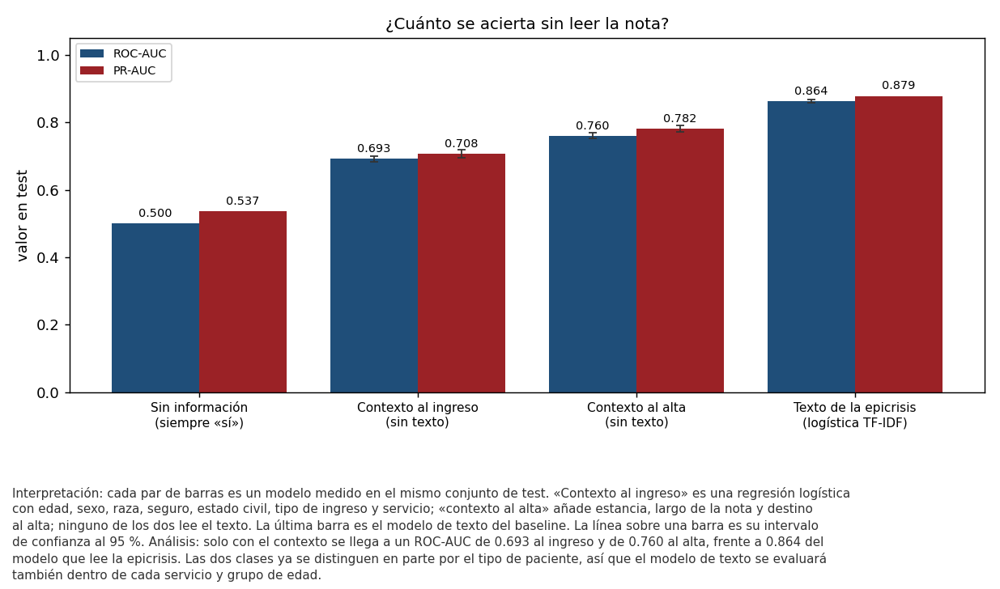

Se ajustó en train una regresión logística que no lee el texto, sin buscar hiperparámetros, y se midió en el mismo test del baseline. Tiene dos versiones: con lo que se sabe al ingreso (edad, sexo, raza, seguro, estado civil, tipo de ingreso y servicio) y con lo que se sabe al alta (se añaden estancia, largo de la nota y destino al alta). No incluye el número de diagnósticos ni la severidad APR-DRG.

| Modelo (test) | ROC-AUC | IC 95 % | PR-AUC |
|---|---|---|---|
| Siempre «sí» | 0.500 | | 0.537 |
| Contexto al ingreso, sin texto | 0.693 | 0.683 a 0.701 | 0.708 |
| Contexto al alta, sin texto | 0.760 | 0.752 a 0.769 | 0.782 |
| Texto de la epicrisis (logística TF-IDF del baseline) | 0.864 | 0.858 a 0.869 | 0.879 |

El intervalo de confianza de los modelos de contexto se obtuvo remuestreando pacientes del test; el del modelo de texto es el que reporta el baseline. Sin leer una sola palabra de la nota ya se separan las clases con un ROC-AUC de 0.693 al ingreso y de 0.760 al alta. El modelo de texto llega a 0.864, pero este resultado obliga a preguntarse cuánto de eso viene de reconocer el tipo de paciente y cuánto de reconocer el evento. Este hallazgo sustenta la decisión 3.

### 3 · El texto de la epicrisis

#### 3.1 · Largo de la nota (atajo)
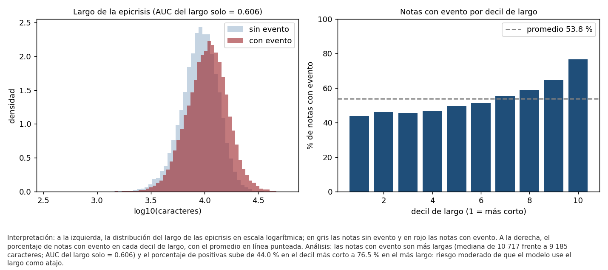

Las notas con evento son más largas (mediana de 10 717 frente a 9 185 caracteres). El largo solo da un AUC de 0.606, y la proporción de positivas sube de 44.0 % en el decil más corto a 76.5 % en el más largo. Hay un riesgo moderado de que el modelo aprenda «nota larga = evento». El largo se mueve junto con la estancia (Spearman 0.468) y con el número de diagnósticos (0.559): una hospitalización larga y compleja produce una nota larga.

#### 3.2 · Secciones y vocabulario
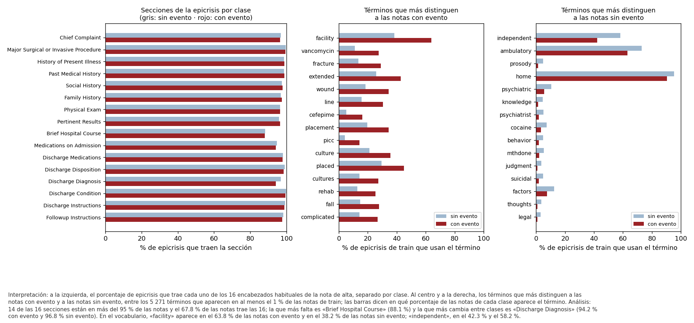

Se buscó en cada nota la presencia de 16 encabezados habituales de la epicrisis de MIMIC-IV, que es el equivalente a los datos faltantes dentro del texto. Catorce de los 16 están en más del 95 % de las notas y el 67.8 % de las notas trae los 16. El que más falta es el curso hospitalario (*Brief Hospital Course*, 88.1 %) y el que más cambia entre clases es el diagnóstico de alta (*Discharge Diagnosis*: 94.2 % con evento y 96.8 % sin evento). El número de secciones no separa las clases (AUC 0.493): la estructura de la nota es la misma en las dos y no es un atajo.

Para el vocabulario se contaron, solo en train, los 5 271 términos que aparecen en al menos el 1 % de las notas, y se ordenaron por cuánto más aparecen en una clase que en la otra (razón de odds dividida entre su error estándar, para que un término raro no quede arriba solo por ser raro).

- **Más propios de las notas con evento:** *facility* (63.8 % de las notas con evento y 38.2 % de las notas sin evento), *vancomycin*, *fracture*, *extended*, *wound*, *line*, *cefepime*, *placement*, *picc*, *culture*, *placed*, *cultures*, *rehab*, *fall* y *complicated*.
- **Más propios de las notas sin evento:** *independent* (42.3 % y 58.2 %), *ambulatory*, *prosody*, *home*, *psychiatric*, *knowledge*, *psychiatrist*, *cocaine*, *behavior*, *mthdone*, *judgment*, *suicidal*, *factors*, *thoughts* y *legal*.

El vocabulario confirma los dos hallazgos del punto 2. Del lado del evento hay palabras ligadas a complicaciones (*wound*, *complicated*) y a infecciones y catéteres (*vancomycin*, *cefepime*, *picc*, *line*), que también describen a un paciente complejo; y hay palabras del destino del paciente (*facility*, *rehab*, *extended*) y de las caídas con fractura (*fall*, *fracture*), que se revisan en el punto 4.2. Del lado sin evento no hay palabras de «ausencia de evento»: son términos de notas psiquiátricas (*psychiatric*, *suicidal*, *prosody*) y de pacientes que se van a casa caminando (*home*, *ambulatory*, *independent*). El modelo puede reconocer la clase negativa por la especialidad y por el estado funcional.

#### 3.3 · Fugas de información
- **Códigos CIE en el texto.** La versión anterior reportó cadenas con forma de código CIE-10 en el 4.95 % de las positivas y el 4.45 % de las negativas, y propuso enmascararlas. Al revisar qué captura ese patrón, el 72.5 % de las 4 241 coincidencias son `T95` a `T99` con un decimal (las más frecuentes, `T98.2`, `T98.1` y `T98.3`): por su valor son temperaturas corporales en grados Fahrenheit, y en el diccionario de diagnósticos de MIMIC-IV no existe ningún código T95 a T99. Se repitió la búsqueda solo con los códigos de las familias de las que sale la etiqueta, escritos con punto: con la forma de CIE-10 aparecen en 20 notas, todas positivas, y con la forma de CIE-9 en 24 (17 positivas y 7 negativas). Son 44 notas en total: el 0.10 % de las positivas y el 0.02 % de las negativas. La búsqueda es por patrón, y un número con la misma forma también cuenta, así que es una cota superior. No hay fuga, y la decisión de enmascarar se retira.
- **Pacientes.** Ningún paciente está a la vez en train y en test.

### 4 · La variable objetivo
La variable objetivo es binaria: la epicrisis corresponde, o no, a una hospitalización con un evento adverso. La etiqueta no se anotó a mano; sale de códigos de diagnóstico que el proyecto toma como señal de un daño causado por la atención. En la época CIE-10 son los códigos de la tabla del proyecto que pertenecen a estas familias: complicaciones de la atención médica y quirúrgica (T80 a T88), incidentes en la asistencia (Y63, Y65), procedimientos como causa de una reacción anormal (Y83, Y84), caídas (W00 a W19) y úlcera por presión (L89), más los efectos adversos de medicamentos en uso terapéutico y algunas complicaciones de procedimientos que se identifican por sus equivalentes en CIE-10-CM. En la época CIE-9 se usan cinco familias completas. Los códigos de condiciones como la insuficiencia renal aguda, la neumonía o la sepsis no dan etiqueta, porque la tabla de diagnósticos de MIMIC-IV no indica si la condición ya estaba presente al ingreso.

#### 4.1 · Balance, prevalencia real y drift
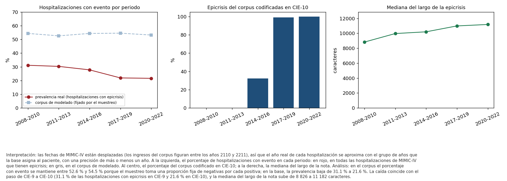
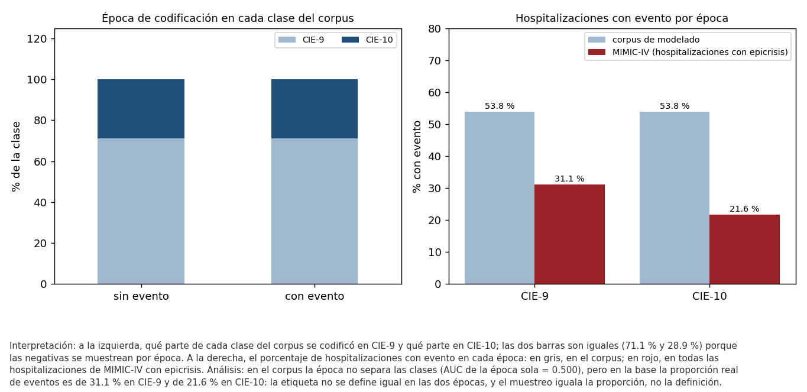

El corpus de modelado tiene 53.8 % de positivas (53.9 % en train y 53.7 % en test) porque se construye tomando una proporción fija de negativas por cada positiva dentro de cada época de codificación. Ese balance no es el de la realidad, así que se midió la proporción de eventos en toda la base:

| | Hospitalizaciones con diagnóstico | % con evento | Con epicrisis | % con evento entre las que tienen epicrisis |
|---|---|---|---|---|
| Todas | 545 497 | 20.12 | 331 604 | 27.59 |
| Época CIE-9 | 291 120 | 25.67 | 209 316 | 31.06 |
| Época CIE-10 | 254 377 | 13.77 | 122 288 | 21.64 |
| 2008-2010 | 103 317 | 25.35 | 70 862 | 31.12 |
| 2011-2013 | 116 824 | 25.11 | 85 637 | 30.31 |
| 2014-2016 | 116 967 | 22.83 | 87 640 | 27.78 |
| 2017-2019 | 113 866 | 16.44 | 79 789 | 21.90 |
| 2020-2022 | 94 523 | 9.32 | 7 676 | 21.60 |

Las fechas de MIMIC-IV están desplazadas (los ingresos del corpus figuran entre los años 2110 y 2211), así que el año real de cada hospitalización se aproximó con el grupo de años que la base asigna a cada paciente, con una precisión de más o menos un año.

De esta tabla se desprenden tres hallazgos:

1. **La prevalencia que corresponde al modelo es 27.6 %, no 20.1 %.** El modelo solo puede leer hospitalizaciones con epicrisis. Además, las tres fuentes de positivas no tienen la misma cobertura de notas: tienen epicrisis el 100 % de las positivas por códigos de la tabla (esa tabla se armó a partir de las notas), el 87.0 % de las de familias CIE-9 y el 55.2 % de las de equivalencias CIE-10-CM. El valor predictivo positivo «a prevalencia real» del baseline se calculó con 20.1 % y hay que recalcularlo.
2. **La etiqueta no es estable en el tiempo.** La proporción real de eventos baja de 31.1 % en 2008-2010 a 21.6 % en 2020-2022. La caída está en el cambio de codificación: dentro del mismo periodo 2014-2016, las hospitalizaciones codificadas en CIE-9 tienen 32.2 % de eventos y las codificadas en CIE-10, 21.2 %. La diferencia aparece con el cambio de codificación y no con el paso del tiempo, y la explica la definición de la etiqueta: familias completas en CIE-9 y una lista de códigos en CIE-10. Si en CIE-10 dieran etiqueta todos los códigos de esas familias, la proporción de eventos entre las hospitalizaciones con epicrisis sería 31.8 %, prácticamente la de CIE-9 (31.1 %).
3. **El muestreo por época iguala la proporción, no la definición.** En el corpus la época no separa las clases (AUC de la época sola = 0.500; 71.1 % CIE-9 y 28.9 % CIE-10 en ambas), y eso evita que el modelo aprenda la época en lugar del evento. Pero una positiva de CIE-9 y una de CIE-10 no significan lo mismo, y por eso las métricas se reportarán también por época.

En el corpus, lo que varía con los años es la forma de documentar: la mediana del largo de la nota sube de 8 826 caracteres en 2008-2010 a 11 182 en 2020-2022. El último periodo tiene solo 1 194 notas, así que sus métricas tendrán intervalos anchos.

#### 4.2 · Ruido de la etiqueta
Se revisó cada clase buscando casos que, por los códigos de la propia base, podrían estar mal puestos.

**Negativas con códigos de causa explícita.** De las 9 345 negativas de la época CIE-10, 805 (8.6 %) llevan un código de las mismas familias que dan la etiqueta, pero que no está en la tabla del proyecto: 451 un código de las familias T80 a T88, Y63, Y65, Y83, Y84, W00 a W19 o L89, y 368 un efecto adverso de medicamento (T36 a T50 con el carácter de efecto adverso). Los más frecuentes son el efecto adverso de glucocorticoides (T38.0X5A, 102 notas) y dos procedimientos quirúrgicos como causa de una reacción (Y83.8, 88 notas; Y83.1, 71 notas). En la época CIE-9, donde se usan las familias completas, no hay ninguna (0 de 22 963). Esas 805 notas ingresan al entrenamiento como negativas. Este hallazgo sustenta la decisión 1.

**Positivas que lo son solo por una caída.** 6 296 positivas (16.7 %) tienen como única evidencia un código de caída. Los códigos de caída son de causa externa: dicen que hubo una caída, no dónde ocurrió; el lugar va en otro código.

| | Positivas solo por caída | Con código de lugar | Lugar: hospital | Lugar: casa |
|---|---|---|---|---|
| Época CIE-10 | 2 010 | 1 706 | 159 (7.9 %) | 884 |
| Época CIE-9 | 4 286 | 1 630 | — | 813 |

Los códigos de lugar se tomaron con el título que tienen en el diccionario de MIMIC-IV: en CIE-10, Y92.23 (hospital) e Y92.0 (residencia privada); en CIE-9, E849.0 (accidentes en el hogar). Ninguno de los diez códigos de lugar de CIE-9 que trae el diccionario corresponde al hospital; el más cercano es E849.7 (accidentes en institución residencial), con 240 casos. En total, solo 159 de las 6 296 tienen el hospital como lugar de ocurrencia, y 2 960 no tienen código de lugar. Donde se conoce el lugar, lo más frecuente es la casa, es decir, una caída anterior al ingreso: no es un evento adverso de la atención. Explican buena parte de las diferencias por servicio del punto 2.3: son solo por caída el 74.2 % de las positivas de `TRAUM`, el 51.1 % de las de `NSURG` y el 47.7 % de las de `ORTHO`. Este hallazgo sustenta la decisión 2.

**Positivas de la familia de úlcera en CIE-9.** La familia que el proyecto llama «úlcera por presión» se define en CIE-9 como 707.x. De sus 2 736 positivas, 1 739 (63.6 %) no tienen ningún código 707.0x, que es el de úlcera por presión, y 1 652 de ellas tienen un código 707.1x, úlcera de miembro inferior. Es otra fuente de positivas que no corresponden al evento, y queda registrada como acción.

#### 4.3 · Naturaleza del evento
Para la segunda etapa del modelo las positivas se agrupan en seis naturalezas, que salen de la naturaleza asignada a cada código (es una agrupación propia del modelo, distinta de las 12 naturalezas del catálogo del punto 5). Se ven en el panel inferior derecho de la figura del punto 1.

| Naturaleza | Notas | En CIE-9 | En CIE-10 |
|---|---|---|---|
| Procedimiento | 17 209 | 13 005 | 4 204 |
| Cuidado del paciente | 10 305 | 7 155 | 3 150 |
| Medicación | 9 933 | 6 630 | 3 303 |
| Dispositivo médico | 1 198 | 0 | 1 198 |
| Infección nosocomial | 1 007 | 0 | 1 007 |
| Sistema/Organización | 130 | 0 | 130 |

Tres naturalezas existen solo en la época CIE-10, porque las familias de CIE-9 no las distinguen. Por la misma razón, ninguna positiva de CIE-9 tiene más de una naturaleza, frente al 17.1 % de las de CIE-10 (5.0 % en total). Sistema/Organización no se puede evaluar con 130 notas.

### 5 · Los 231 eventos del Anexo 02
El catálogo de los 231 eventos (12 naturalezas) y la tabla de códigos están versionados en [`data/catalogos/`](data/catalogos/). El resultado por evento, con una fila para cada uno de los 231, está en [`reportes/eda_eventos_231.csv`](reportes/eda_eventos_231.csv). La columna `nombre_oficial` del catálogo reproduce el nombre de cada evento según la tabla del Anexo 02 de la Directiva (páginas 30 a 38 del PDF), sin corregir su ortografía y uniendo con un espacio las líneas de una misma celda. La columna `nombre` conserva el nombre de trabajo del proyecto, con el que el EDA enlaza las tablas, y difiere del oficial en 72 eventos por sufijos que distinguen nombres repetidos, nombres acortados o resumidos, correcciones ortográficas o espacios.

La tabla de la etiqueta mezcla los números oficiales del Anexo 02 con números internos y reutiliza algunos; por ejemplo, el 301 identifica en ella tanto el error en el diagnóstico (Y65.8), que es su significado oficial, como una hemorragia postprocedimiento (T81.0). Por ello, [`data/catalogos/anexo02_equivalencia_cie10_oficial.csv`](data/catalogos/anexo02_equivalencia_cie10_oficial.csv) establece la equivalencia de cada código con los eventos oficiales. La propuesta se construyó con reglas explícitas a partir del título oficial del código en la CIE-10 de la OMS (versión 2019) o en la CIE-10-CM, y el autor la validó código por código el 29 de octubre de 2026, en un instrumento de validación que registra cada decisión con su fecha; ese mismo día precisó el alcance de 20 de sus decisiones y corrigió 3, lo cual consta en la columna `aclaracion_autor`. De los 223 códigos distintos, 131 quedaron con un evento oficial, que suman 60 eventos distintos, 24 solo con la naturaleza y 27 sin equivalente, y 41 se marcaron como no evento adverso. Con esas precisiones, la validación modificó la propuesta en 46 códigos y dejó sin cambio 177. En los códigos con evento, si el evento ocurrió durante la atención lo decide el contexto de la epicrisis y no el código. La columna `nota` señala los casos detectados de códigos de la OMS con otro alcance en la CIE-10-CM, con la que se codifica MIMIC-IV, y las descripciones de la tabla de la etiqueta que no corresponden al título del código. La equivalencia no modifica la etiqueta del modelo. Ninguno de los 41 códigos marcados como no evento adverso pertenece al estrato A1 ni a sus equivalencias CIE-10-CM, que, junto con las cinco familias CIE-9, son las fuentes de las positivas, de modo que ninguna positiva depende de ellos. Todos son del estrato A2, el cual no aporta positivas, pero excluye del sorteo de las negativas a las hospitalizaciones que los tienen.

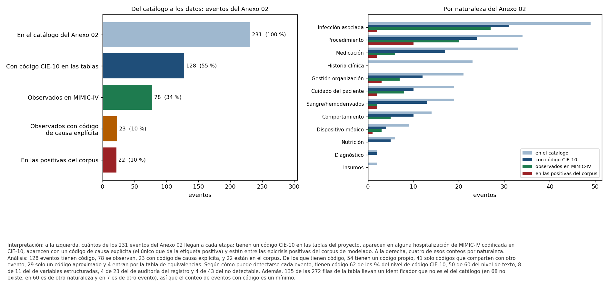

Se siguió a cada evento del catálogo hasta los datos, en cinco etapas que se contienen una a otra:

| Etapa | Eventos | % del catálogo |
|---|---|---|
| En el catálogo del Anexo 02 | 231 | 100 |
| Con código CIE-10 en las tablas del proyecto | 128 | 55 |
| Observados en alguna hospitalización de MIMIC-IV (época CIE-10) | 78 | 34 |
| Observados con un código de causa explícita, el que da la etiqueta | 23 | 10 |
| Presentes en las epicrisis positivas del corpus | 22 | 10 |

| Naturaleza (Anexo 02) | En el catálogo | Con código | Observados | Con código de causa explícita | En las positivas del corpus |
|---|---|---|---|---|---|
| Infección asociada | 49 | 31 | 27 | 3 | 2 |
| Procedimiento | 34 | 24 | 20 | 10 | 10 |
| Medicación | 33 | 17 | 6 | 2 | 2 |
| Historia clínica | 23 | 0 | 0 | 0 | 0 |
| Gestión organización | 21 | 12 | 7 | 3 | 3 |
| Cuidado del paciente | 19 | 10 | 8 | 2 | 2 |
| Sangre/hemoderivados | 19 | 13 | 2 | 2 | 2 |
| Comportamiento | 14 | 10 | 5 | 0 | 0 |
| Dispositivo médico | 9 | 4 | 3 | 1 | 1 |
| Nutrición | 6 | 5 | 0 | 0 | 0 |
| Diagnóstico | 2 | 2 | 0 | 0 | 0 |
| Insumos | 2 | 0 | 0 | 0 | 0 |
| **Total** | **231** | **128** | **78** | **23** | **22** |

**Qué código tiene cada evento.** De los 128 eventos con código, 54 tienen un código propio, 41 solo códigos que comparten con otro evento, 29 solo un código aproximado y 4 entran por la tabla de equivalencias CIE-10-CM. Los 103 restantes no tienen código: Historia clínica (23 eventos) e Insumos (2) no tienen ninguno, y Nutrición y Diagnóstico tienen código pero ningún caso. Según cómo puede detectarse cada evento, tienen código 62 de los 94 que se detectan por código CIE-10, 50 de los 60 que se detectan en el texto de las notas, 8 de los 11 que requieren variables estructuradas, 4 de los 23 que requieren auditar el registro y 4 de los 43 que no son detectables en MIMIC-IV.

**Qué evidencia hay de cada evento.** De los 78 eventos observados, 55 aparecen solo con códigos de condición, que el proyecto no usa como etiqueta porque pueden ser el motivo de ingreso. Solo 23 tienen algún caso con código de causa explícita, y 22 llegan a las positivas del corpus.

**Calidad de la tabla de códigos.** La tabla tiene 272 filas y 223 códigos. En 135 filas, todas tomadas de la CIE-10 de la OMS, el identificador del evento no es el del catálogo: en 68 no existe en el catálogo, en 60 corresponde a otra naturaleza y en 7 a otro evento de la misma naturaleza. Esas filas describen complicaciones (hemorragia tras un procedimiento, infección tras un procedimiento, úlcera por presión), pero no dicen a qué evento del catálogo corresponden. Por eso el conteo de 128 es un mínimo: de los 32 eventos que se detectan por código CIE-10 y quedan sin código, al menos 12 tienen su código en una de esas filas. No afecta a la etiqueta binaria ni a la naturaleza, que se asignan por código.

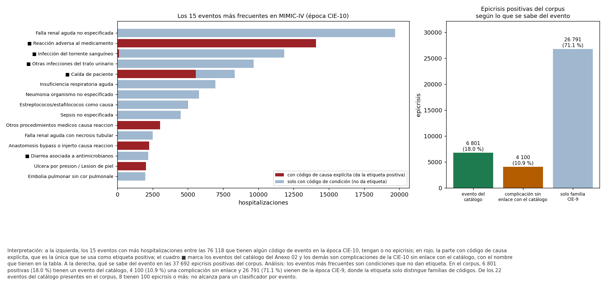

**Frecuencia y origen de la etiqueta.** Contando también las complicaciones sin enlace, se observan 157 eventos en 76 118 hospitalizaciones de la época CIE-10 (tengan o no epicrisis), y 24 de ellos concentran el 80 % de los casos. El más frecuente, la falla renal aguda no especificada (19 705 hospitalizaciones), es una condición y no da etiqueta. Los que más aportan a la etiqueta son la reacción adversa al medicamento (14 090) y la caída de paciente (5 551).

En el corpus, de las 37 692 epicrisis positivas, 6 801 (18.0 %) tienen un evento del catálogo, 4 100 (10.9 %) una complicación sin enlace con el catálogo y 26 791 (71.1 %) vienen de la época CIE-9, donde la etiqueta solo distingue cinco familias: complicaciones de la atención (11 504), fármacos en uso terapéutico (6 630), caídas (4 419), úlcera de piel, 707.x (2 737) e incidentes asistenciales (1 501). De los 22 eventos del catálogo presentes en el corpus, solo 8 tienen 100 epicrisis o más y 7 tienen 30 o más en test.

En cuanto a la presencia de los 231 eventos en los datos, algo más de la mitad tiene código, un tercio se llega a observar, y solo uno de cada diez participa en la etiqueta con la que se entrena el modelo. Los eventos de historia clínica y de insumos no tienen código de diagnóstico, y los de comportamiento, nutrición y diagnóstico no aparecen con código de causa explícita: para ellos haría falta el texto de las notas u otras tablas. Con estos datos no se puede entrenar un clasificador por evento, y por eso el modelo trabaja en dos etapas: primero detección binaria y después naturaleza del evento.

### 6 · Correlaciones
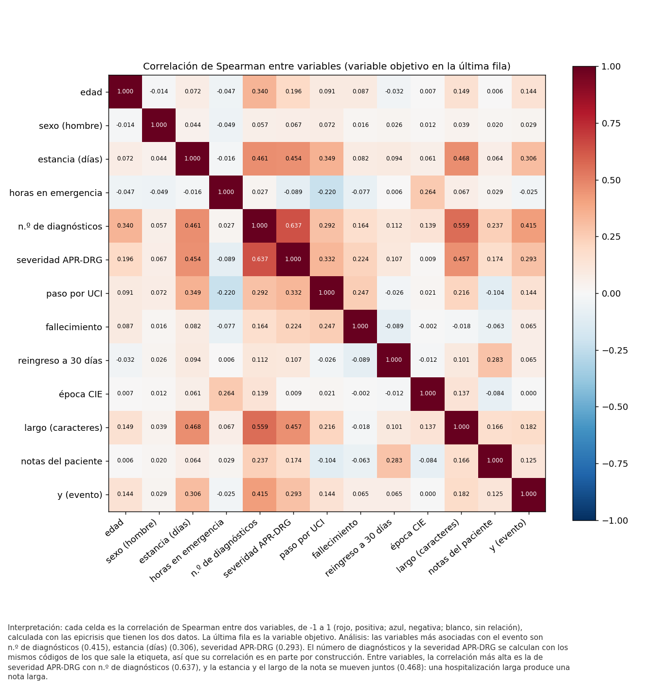

Matriz de correlación de Spearman entre 12 variables y la variable objetivo, que va en la última fila; cada celda usa las epicrisis que tienen los dos datos. Con la etiqueta, las correlaciones más altas son las del número de diagnósticos (0.415), la estancia (0.306), la severidad APR-DRG (0.293), el largo de la nota (0.182), la edad (0.144) y el paso por UCI (0.144); la época de codificación da 0.000. Entre las variables, las más altas son severidad con número de diagnósticos (0.637), número de diagnósticos con largo de la nota (0.559) y estancia con largo de la nota (0.468).

Ninguna variable aislada explica la etiqueta, pero varias empujan en la misma dirección y están correlacionadas entre sí: describen al paciente complejo, con muchos diagnósticos, estancia larga y nota larga. Es la misma lectura del punto 2.4.

### Resumen de riesgos
| Riesgo | Evidencia | Estado |
|---|---|---|
| Desbalance | 53.8 % de positivas en el corpus; 27.6 % en las hospitalizaciones con epicrisis | PR-AUC como métrica central; recalcular el valor predictivo positivo con 27.6 % |
| Ruido en las negativas | 8.6 % de las negativas CIE-10 con un código de causa explícita que no está en la tabla | Decisión 1 |
| Ruido en las positivas | 16.7 % de las positivas solo por caída y solo 159 con el hospital como lugar; 1 739 positivas de la familia de úlcera en CIE-9 sin código de úlcera por presión | Decisión 2 y acción registrada |
| Mezcla de casos | Sin leer la nota se llega a ROC-AUC 0.693 (ingreso) y 0.760 (alta); el modelo de texto, 0.864 | Decisión 3 |
| Atajo por largo | AUC del largo solo = 0.606; positivas por decil de 44.0 % a 76.5 % | Decisión 3 |
| Sesgo por subgrupo | Evento de 10.1 % a 71.7 % según el servicio; V de Cramér 0.225 | Métricas por subgrupo |
| Drift de la etiqueta | Prevalencia real de 31.1 % en CIE-9 y 21.6 % en CIE-10; en el corpus queda igualada por el muestreo | Métricas por época y por periodo |
| Fuga de la etiqueta | Códigos de las familias de la etiqueta escritos en 44 notas (0.10 % de las positivas) | Controlado; no se enmascara |
| Fuga por paciente | 0 pacientes compartidos entre train y test | Controlado por la partición por paciente |
| Variables contaminadas | N.º de diagnósticos (AUC 0.740) y severidad APR-DRG (0.662) salen de la codificación | No se usan como predictores |
| Faltantes no aleatorios | Destino al alta falta en 12.5 %; 31.7 % de positivas cuando falta y 57.0 % cuando no | El faltante se conserva como categoría |
| Etiqueta débil | Sale de códigos de diagnóstico de facturación, no de una lectura clínica de la nota | Se declara como limitación |
| Cobertura del catálogo | 128 de 231 eventos con código; 22 en el corpus; 135 de 272 filas de la tabla sin enlace | Enlazar las filas; modelo por naturaleza |
| Clases raras | Sistema/Organización con 130 notas; tres naturalezas solo en CIE-10 | Evaluación por naturaleza y por época |

### Decisiones para el Sprint 2
1. **Excluir de la clase negativa las hospitalizaciones que tengan cualquier código de las familias de causa explícita** [preprocesado]. Hoy el 8.6 % de las negativas de la época CIE-10 lleva uno (805 de 9 345) y en CIE-9 ninguna. Control: ese porcentaje debe quedar en 0 % al regenerar el corpus; se reporta la PR-AUC antes y después.
2. **Dejar como positivas por caída solo las que tienen el hospital como lugar de ocurrencia y sacar las demás de las dos clases** [preprocesado]. Hoy 6 296 positivas (16.7 %) lo son solo por un código de caída y solo 159 tienen el hospital como lugar; las demás ocurrieron en otro lugar, no tienen código de lugar (2 960) o son de la época CIE-9, que no tiene un código de lugar para el hospital. Control: positivas solo por caída sin el hospital como lugar de ocurrencia, hoy 6 137 de 6 296 (97.5 %), deben quedar en 0; se reporta la PR-AUC antes y después.
3. **Evaluar el modelo dentro de cada servicio, grupo de edad y decil de largo, y compararlo con el modelo de contexto sin texto** [evaluación]. Un modelo que no lee la nota llega a ROC-AUC 0.693 y 0.760. Control: ROC-AUC del modelo de texto mayor que el del modelo de contexto en cada estrato con 200 epicrisis o más en test, con un intervalo de confianza al 95 % por paciente para la diferencia que no incluya el cero.

En `logs/metrics_eda.txt` quedan registradas las demás acciones que salen del análisis: recalcular el valor predictivo positivo con la prevalencia de 27.6 %, reportar las métricas por época, periodo y subgrupo, enlazar con el catálogo las 135 filas de la tabla de códigos, limitar la familia CIE-9 de úlcera a los códigos 707.0x, no usar como predictores el número de diagnósticos ni la severidad APR-DRG, mantener la segunda etapa a nivel de naturaleza, tratar como faltante la estancia de las 11 hospitalizaciones con estancia negativa y no enmascarar códigos CIE. La PR-AUC, adoptada en la semana 3, sigue como métrica central.

---

## 🧪 Feature engineering (Semana 5 · rama `sprint2-feature-engineering`)

Las tablas y la figura de esta sección también están en la sección 7 del cuaderno [`notebooks/02_EDA_semana4.ipynb`](notebooks/02_EDA_semana4.ipynb), debajo del EDA.

Sigue la guía «Iteración guiada por EDA + Feature Engineering básico» de la semana 4. Hay un baseline y tres variantes; cada variante agrega **un solo bloque de atributos** respecto del baseline (diseño de ablación A, A+B, A+C, A+B+C). El modelo no cambia: es la misma regresión logística del baseline, sin ajuste de hiperparámetros.

### Configuraciones
| Config | Qué agrega al baseline | Tipo de feature engineering (guía) |
|---|---|---|
| **A** (baseline) | TF-IDF de palabras sueltas, 20 000 términos: el modelo de la semana 3 sin cambios | — |
| **A+B** | Bigramas de palabras, 20 000 términos (p. ej., *pressure ulcer*) | Creación y transformación del texto |
| **A+C** | 18 variables de la hospitalización y el largo de la nota | Dominio, transformación y codificación |
| **A+B+C** | Los dos bloques | Combinación |

### Features añadidas (bloque C) y sus transformaciones
| Grupo | Variables | Tabla de MIMIC-IV | Transformación (ajustada solo en train) |
|---|---|---|---|
| Paciente | edad, horas en emergencia, sexo, tipo de ingreso, procedencia, seguro | patients, admissions | edad: mediana y escalado; horas: log1p, winsorización p1–p99 y escalado; categóricas: one-hot |
| Servicio | servicio al ingreso, servicio al alta, n.º de servicios distintos, paso por servicio quirúrgico | services | conteo: log1p, winsorización y escalado; categóricas: one-hot; binaria |
| Hospitalización | estancia (días), n.º de traslados, n.º de unidades distintas, días en UCI, paso por UCI, destino al alta | admissions, transfers, icustays | conteos: log1p, winsorización y escalado; categórica: one-hot; binaria |
| Atención | n.º de medicamentos distintos prescritos, n.º de muestras para cultivo | prescriptions, microbiologyevents | log1p, winsorización y escalado |
| Nota | largo de la epicrisis | discharge | log1p, winsorización p1–p99, escalado y marca de nota atípica (> p99) |

- **Categóricas:** las categorías con menos de 50 casos en train se agrupan en una sola, y el faltante es una categoría propia.
- **Numéricas:** llevan además una columna que marca el faltante. Las horas en emergencia faltan en el 33.2 % de las notas, que son las de los pacientes que no pasaron por emergencia, y el destino al alta en el 12.5 %.
- **Servicio quirúrgico:** SURG, CSURG, NSURG, VSURG, TSURG, PSURG, ORTHO y TRAUM. La agrupación es un *criterio del autor* a partir del nombre del código.
- **Features que quedaron fuera a propósito:** el n.º de diagnósticos, la severidad APR-DRG y los procedimientos CIE, porque salen de la codificación de facturación (decisión del EDA de la semana 4). También el fallecimiento y el reingreso, porque son desenlaces y no predictores.
- **Ventana:** todas las variables cubren la hospitalización completa, igual que la epicrisis. Sirven para detectar el evento al alta, no para predecirlo durante la estancia.

### Validación y control de fuga
- **Split:** el mismo de las semanas 3 y 4. Train tiene 55 915 notas y test 14 085, separados por paciente.
- **Validación cruzada:** `StratifiedGroupKFold` de 5 folds dentro de train, estratificada por la etiqueta y agrupada por paciente, con semilla 42.
- **Cero fuga:**
  - Todas las transformaciones (TF-IDF, imputación, log1p, winsorización, escalado y one-hot) están dentro de un `sklearn.pipeline` y se ajustan solo con la parte de entrenamiento de cada fold.
  - El script comprueba con una aserción que ningún paciente esté en dos partes: ni entre los folds ni entre train y test.
  - El test se usó **una sola vez**, al final; la elección de la configuración se hizo solo con la validación cruzada.
- **Control:** la configuración A medida en test reproduce la logística de la semana 3 (PR-AUC 0.8787, diferencia 0.0000).

### Resultados
**Validación cruzada** (media ± desviación estándar de 5 folds). La métrica principal es la PR-AUC. El F1 y el recall son de la clase positiva con umbral 0.5. El tiempo es el de entrenamiento por fold.

| Config | **PR-AUC** | Diferencia con A (folds mejores) | F1 (+) | Recall | ROC-AUC | Atributos | Tiempo (s) |
|---|---|---|---|---|---|---|---|
| A (baseline) | 0.8667 ± 0.0035 | — | 0.7806 ± 0.0062 | 0.7585 ± 0.0101 | 0.8506 ± 0.0017 | 20 000 | 141 |
| A+B | 0.8688 ± 0.0034 | +0.0021 ± 0.0006 (5/5) | 0.7824 ± 0.0053 | 0.7618 ± 0.0082 | 0.8522 ± 0.0021 | 40 000 | 287 |
| A+C | 0.8714 ± 0.0021 | +0.0047 ± 0.0016 (5/5) | 0.7828 ± 0.0048 | 0.7621 ± 0.0091 | 0.8549 ± 0.0017 | 20 092 | 89 |
| **A+B+C** | **0.8732 ± 0.0025** | **+0.0065 ± 0.0017 (5/5)** | 0.7844 ± 0.0058 | 0.7651 ± 0.0092 | 0.8562 ± 0.0021 | 40 092 | 240 |

**Test** (una sola medición). El intervalo de confianza al 95 % de la PR-AUC se obtuvo remuestreando pacientes 200 veces. El valor predictivo positivo está calculado con la prevalencia real de las hospitalizaciones con epicrisis (27.59 %, EDA de la semana 4).

| Config | **PR-AUC** | IC 95 % | F1 (+) | Recall | ROC-AUC | VPP real |
|---|---|---|---|---|---|---|
| A (baseline) | 0.8787 | 0.8709–0.8861 | 0.7911 | 0.7712 | 0.8637 | 0.5873 |
| A+B | 0.8798 | 0.8719–0.8869 | 0.7933 | 0.7736 | 0.8646 | 0.5904 |
| A+C | 0.8822 | 0.8747–0.8892 | 0.7946 | 0.7736 | 0.8676 | 0.5946 |
| **A+B+C** | **0.8830** | 0.8754–0.8905 | 0.7934 | 0.7754 | 0.8681 | 0.5873 |

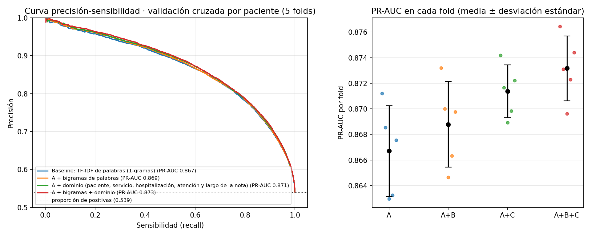

En el gráfico de la izquierda, el eje x es la sensibilidad y el eje y la precisión de cada configuración, calculadas con las predicciones de validación cruzada: cada nota se predice con el modelo del fold en el que no participó. Más arriba es mejor, y la línea punteada es la proporción de positivas de train (0.539). En el de la derecha, el eje x son las cuatro configuraciones y el eje y la PR-AUC de cada fold (puntos), con su media y su desviación estándar.

Las cuatro curvas casi se superponen: la diferencia entre configuraciones es pequeña frente a la distancia que las separa del piso de 0.539. El orden, en cambio, es consistente: las tres variantes superan al baseline en los 5 folds, y A+B+C es la mejor de las cuatro en los 5 folds. Su mejora (+0.0065) es casi cuatro veces su propia variabilidad entre folds (± 0.0017). En test se mantiene el mismo orden (0.8787 → 0.8830), aunque los intervalos de las cuatro configuraciones se solapan.

El feature engineering mejora al baseline de forma pequeña pero sistemática. El bloque de dominio aporta más que los bigramas (+0.0047 frente a +0.0021), y juntos aportan casi lo mismo que la suma de los dos por separado (+0.0065 frente a +0.0067). Ninguna variante cambia el orden de magnitud del resultado.

### ¿Qué feature aportó más?
Se entrenaron modelos **sin texto**, sumando un grupo de variables de dominio a la vez (validación cruzada, PR-AUC):

| Grupos | PR-AUC sin texto | Aporte del grupo |
|---|---|---|
| Paciente | 0.6552 ± 0.0067 | — |
| + Servicio | 0.7127 ± 0.0066 | +0.0575 |
| + Hospitalización | 0.7684 ± 0.0032 | +0.0557 |
| + Atención | 0.7767 ± 0.0037 | +0.0083 |
| + Nota (largo) | 0.7771 ± 0.0040 | +0.0004 |

La tabla muestra cuánto se puede detectar el evento sin leer la nota y cuánto agrega cada grupo, en el orden en que se suman. El servicio y el paso por el hospital aportan casi todo (+0.0575 y +0.0557). El largo de la nota ya no agrega nada (+0.0004) una vez que se conocen la estancia y los traslados, que es lo que anticipaba el EDA: el largo se mueve con la estancia (Spearman 0.468). Aun así, el dominio solo llega a 0.777, frente a 0.867 del texto solo, así que la mayor parte de la señal está en la nota. En el modelo A+C, la mayoría de los coeficientes de mayor peso son categorías de servicio: obstetricia (OBS) baja la probabilidad de evento y cirugía plástica (PSURG) la sube. Como los coeficientes de un one-hot se leen frente a las demás categorías, los tomo solo como orientación (`logs/metrics_fe.txt`).

El dominio aporta información que el texto no tiene completa: qué servicio atendió al paciente y cómo fue su paso por el hospital. Es la misma «mezcla de casos» que advirtió el EDA de la semana 4, así que parte de la mejora puede venir de reconocer el *tipo de paciente* y no el evento; eso hay que verificarlo antes de adoptar el bloque de forma definitiva.

### Decisión y siguiente sprint
- **Se adopta A+B+C** como nueva referencia del Sprint 2. Es la regla fijada antes de correr: la mayor PR-AUC media en validación cruzada. Mejora en los 5 folds, aunque cuesta 1.7 veces más tiempo de entrenamiento que el baseline. Si el costo importa, A+C conserva el 72 % de la mejora (0.0047 de 0.0065) con el menor tiempo.
- **Falta validar** que el bloque de dominio no sea un atajo por tipo de paciente. Se hará con la decisión 3 del EDA: comparar el modelo dentro de cada servicio, grupo de edad y decil de largo.
- **Próximo experimento (un solo cambio):** depurar la clase negativa (decisión 1 del EDA). Hay que excluir las hospitalizaciones con códigos de causa explícita que no están en la tabla de la etiqueta, y medir la PR-AUC de A+B+C antes y después. El riesgo a controlar es que, al cambiar el corpus, el test cambia, así que la comparación se hace con los mismos pacientes.
- **Ajuste ligero pendiente:** el parámetro `C` de la regresión logística en A+B+C, con tres valores como máximo (guía de la semana 4).

Las cifras de esta sección salen de [`logs/metrics_fe.txt`](logs/metrics_fe.txt), [`reportes/fe_resultados.json`](reportes/fe_resultados.json) y [`reportes/fe_folds.csv`](reportes/fe_folds.csv). La firma de los datos de train (media, p50 y p90 de cada variable numérica) está en `fe_resultados.json`.

---

## 🧹 Variantes de los datos y diagnósticos (Semana 6 · cierre del Sprint 2)

Con la configuración A+B+C de la semana 5 fija, esta semana el cambio está en **los datos**, no en el modelo. El EDA de la semana 4 dejó dos
dudas sobre la etiqueta débil: negativas que tienen códigos de causa explícita que no están en la tabla de la etiqueta, y positivas que lo son
solo por una caída o una úlcera cuyo código no asegura que haya ocurrido en la hospitalización. Probé si limpiar esas filas del
entrenamiento mejora la detección.

### Las tres versiones de los datos
| Variante | Qué filas se quitan del entrenamiento | Train | Test |
|---|---|---|---|
| D0 · datos actuales | ninguna (baseline de esta semana: A+B+C de la semana 5) | 0 | 0 |
| D1 · sin negativas dudosas | negativas con un código de las familias de causa explícita (T80–T88, Y63, Y65, Y83, Y84, W00–W19, L89) o de efecto adverso de medicamento (T36–T50 con 5 en el sexto carácter) que no está en la tabla de la etiqueta; en CIE-9, con un código de las cinco familias | 617 | 188 |
| D2 · sin negativas ni positivas dudosas | lo de D1 y además las positivas cuya única evidencia es una caída sin el hospital como lugar de ocurrencia (en CIE-10, sin Y92.23; en CIE-9 no hay código de lugar para el hospital) o una úlcera CIE-9 (707.x) sin código de úlcera por presión (707.0x) | 6 917 | 1 764 |

De las 6 300 positivas dudosas de train, 4 930 son caídas sin lugar hospitalario y
1 370 úlceras sin código de presión. Las marcas se calculan en [`src/variantes_datos.py`](src/variantes_datos.py).

### Cómo se comparó
- **Mismo modelo y protocolo que la semana 5:** A+B+C, `StratifiedGroupKFold` de 5 folds por paciente (un fold es cada una de las 5 partes
  en que se divide el train: el modelo se entrena con 4 y se evalúa con la que queda, cinco veces, y un paciente nunca está en dos partes),
  semilla 42, todo dentro del `pipeline`.
- **Las variantes solo cambian las filas con que se entrena.** Si cada variante se evaluara con sus propias filas, compararía casos distintos.
  Por eso las tres se evalúan sobre **las mismas filas**: las de validación (y de test) que ninguna variante quita, con la etiqueta original.
  En train son 48 998 filas y en test 12 321.
- **Criterio de adopción** (guía de la semana 6): mejora consistente de la métrica central. Lo apliqué como la mayor PR-AUC media en validación
  cruzada, revisando además en cuántos folds la variante supera a D0.
- El test se usó una sola vez, al final.

### Resultados
**Validación cruzada** (media ± desviación estándar de 5 folds, sobre las mismas filas). La última columna es la PR-AUC con todas las filas y la etiqueta original.

| Variante | Filas de entrenamiento por fold | **PR-AUC** | Diferencia con D0 (folds mejores) | ROC-AUC | F1 (+) | Brier | PR-AUC con todas las filas |
|---|---|---|---|---|---|---|---|
| D0 · datos actuales | 44 732 | 0.8431 ± 0.0028 | — | 0.8480 | 0.7544 | 0.1588 | 0.8732 |
| D1 · sin negativas dudosas | 44 238 | 0.8440 ± 0.0029 | +0.0009 ± 0.0004 (5/5) | 0.8486 | 0.7563 | 0.1586 | 0.8731 |
| **D2 · sin negativas ni positivas dudosas** | 39 198 | **0.8534 ± 0.0041** | +0.0103 ± 0.0023 (5/5) | 0.8582 | 0.7677 | 0.1533 | 0.8477 |

**Test** (una sola medición; IC 95 % remuestreando pacientes; VPP con la prevalencia real de 27.6 %).

| Variante | **PR-AUC** | IC 95 % | F1 (+) | VPP real | PR-AUC con todas las filas |
|---|---|---|---|---|---|
| D0 · datos actuales | 0.8562 | 0.8475–0.8651 | 0.7631 | 0.5890 | 0.8830 |
| D1 · sin negativas dudosas | 0.8575 | 0.8487–0.8662 | 0.7656 | 0.5901 | 0.8828 |
| **D2 · sin negativas ni positivas dudosas** | **0.8671** | 0.8589–0.8749 | 0.7779 | 0.5989 | 0.8580 |

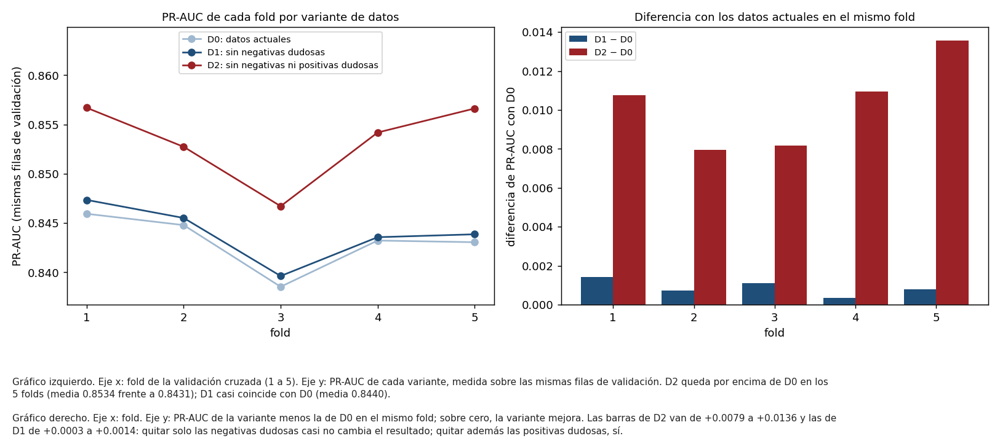

La mejora de D2 aparece en los 5 folds, entre +0.0079 y +0.0136, y la más chica es casi el triple de lo que varía D0 de un fold a
otro. Casi toda viene de quitar las positivas dudosas: D1, que solo quita las negativas, sube apenas +0.0009. Mi lectura es que el
ruido de la etiqueta está sobre todo en las positivas, y que con ellas el modelo aprendía a llamar evento a caídas y úlceras que no se puede
asegurar que hayan ocurrido en la hospitalización. En test D2 también queda arriba (0.8671 frente a
0.8562), pero los intervalos se solapan, así que la decisión se apoya en la comparación por fold.

Con todas las filas y la etiqueta original, en cambio, D2 queda por debajo de D0 en los 5 folds (0.8477 frente a 0.8732 en validación
cruzada; 0.8580 frente a 0.8830 en test). Mi lectura es que deja de marcar como evento justo las caídas y úlceras que la etiqueta original
cuenta como positivas. Elegir D2 supone aceptar que esas positivas no son eventos de la atención: es un criterio mío que sale del EDA, no algo
que el experimento demuestre. Además, D2 deja fuera del entrenamiento casi todas las positivas que lo son solo por una caída (en todo el corpus
quedan 159 de 6 296), así que con estos datos no se puede medir si el modelo reconoce las caídas intrahospitalarias.

### Diagnósticos del modelo (D2)
| Grupo de atributos | Caída de la PR-AUC al barajarlo | En el top 5 |
|---|---|---|
| palabras del texto | 0.1259 | 5/5 |
| bigramas del texto | 0.0333 | 5/5 |
| estancia (días) | 0.0136 | 5/5 |
| servicio al ingreso | 0.0061 | 5/5 |
| largo de la nota | 0.0053 | 4/5 |

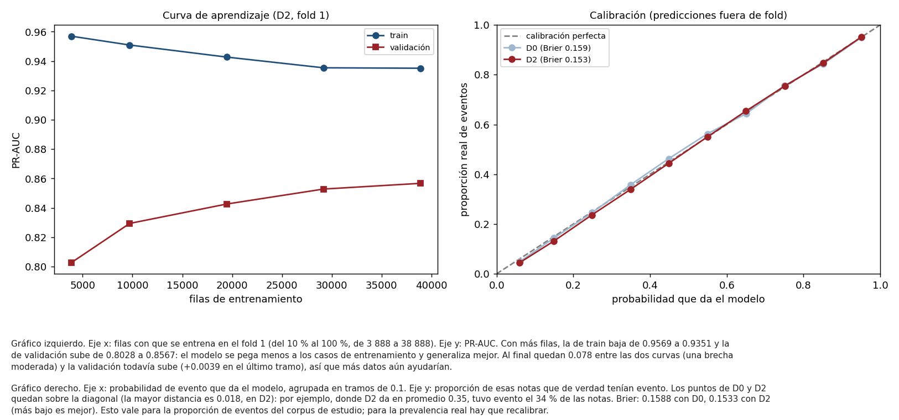

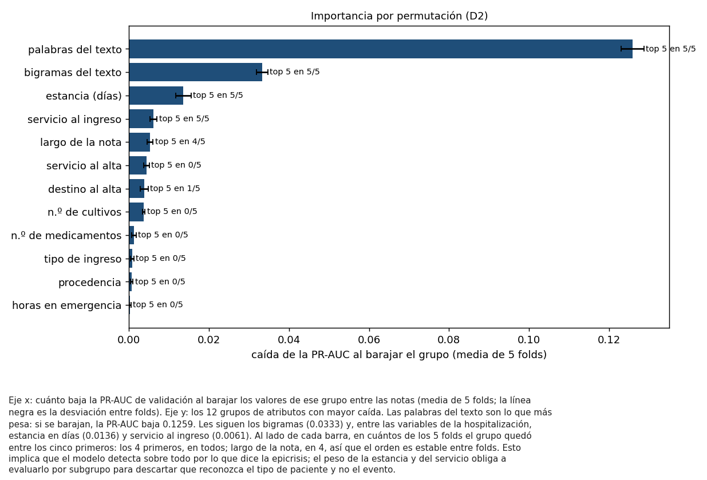

- **Importancia por permutación:** el texto es lo que más pesa, y los tres primeros grupos van en el mismo orden en los 5 folds. Entre las variables
  de la hospitalización pesan la estancia y el servicio, lo que deja la duda de si el modelo reconoce en parte el *tipo de paciente*; se
  revisará con la evaluación por subgrupo.
- **Curva de aprendizaje (fold 1):** train 0.9351 y validación 0.8567 con todas las filas,
  una brecha de 0.078; la validación todavía sube en el último tramo (+0.0039), así que más datos ayudarían y conviene ajustar `C`.
- **Calibración:** las probabilidades siguen la diagonal en el corpus del estudio (Brier 0.1588 con D0 y 0.1533
  con D2). Con la prevalencia real, de cada 10 alertas de D2 unas 6 serían eventos
  (VPP 0.58 en validación cruzada, en las epicrisis sin etiqueta dudosa); para usar la probabilidad como riesgo hay que recalibrar.
- **Colinealidad y coherencia:** VIF máximo 3.05 (número de unidades distintas por las que pasó el paciente), sin colinealidad preocupante. Los tipos y rangos son los
  esperados; solo la categoría DENT del servicio al alta aparece en test sin estar en train, y el modelo la trata como infrecuente.

### Qué significan esos decimales en eventos adversos
Para traducir la PR-AUC a eventos, apliqué la sensibilidad y la especificidad medidas en test (umbral 0.5) a 10 000 hospitalizaciones con
epicrisis con la prevalencia real de 27.6 %: 2 759 con evento según los códigos y 7 241 sin evento.

| Modelo · epicrisis evaluadas | PR-AUC en test | Sensibilidad | Especificidad | Eventos detectados (VP) | Eventos que se escapan (FN) | Falsas alarmas (FP) | VPP: de cada 100 alertas, con evento |
|---|---|---|---|---|---|---|---|
| A, baseline de la semana 3 · todas | 0.8787 | 77.1 % | 79.3 % | 2 128 | 631 | 1 495 | 59 |
| A+B+C (= D0), semana 5 · todas | 0.8830 | 77.5 % | 79.2 % | 2 139 | 620 | 1 503 | 59 |
| D0 (= A+B+C) · sin etiqueta dudosa | 0.8562 | 74.7 % | 80.1 % | 2 061 | 698 | 1 438 | 59 |
| D2 · sin etiqueta dudosa | 0.8671 | 76.9 % | 80.4 % | 2 121 | 638 | 1 421 | 60 |
| D2 · todas, etiqueta original | 0.8580 | 71.9 % | 79.5 % | 1 983 | 776 | 1 484 | 57 |

El feature engineering (+0.0043 de PR-AUC) suma 11 eventos detectados por cada 10 000 hospitalizaciones, con 8 falsas alarmas más: casi
nada. La limpieza de los datos (+0.0109 en las epicrisis sin etiqueta dudosa) suma 60 eventos detectados y quita 17 falsas alarmas, pero esa
cuenta supone que todos los eventos son como los de las epicrisis comparadas, y la prevalencia de 27.6 % incluye las positivas dudosas (una de
cada cinco positivas del corpus, 20.9 %). Con todas las epicrisis y la etiqueta original, D2 detecta 156 eventos codificados menos (1 983
frente a 2 139) y da 19 falsas alarmas menos: los que deja de marcar son, por diseño, los que se quitaron del entrenamiento por dudosos. Por
eso la mejora no se extrapola a toda la base. Los «eventos» son los que marcan los códigos CIE, no una revisión clínica de cada nota.

### Decisión y siguiente sprint
- **Se adopta D2 con A+B+C** como referencia al cierre del Sprint 2.
- **Sprint 3, primer experimento:** evaluar el modelo por servicio, grupo de edad y decil de largo, frente al modelo de contexto sin texto.
- **Ajuste ligero:** el parámetro `C` con pocos valores y la recalibración de las probabilidades a la prevalencia real.

Para reproducir: `python src/experimentos_datos.py` (las figuras se pueden redibujar sin entrenar con `python src/figuras_datos.py`). Las cifras
salen de [`logs/metrics_datos.txt`](logs/metrics_datos.txt), [`reportes/datos_resultados.json`](reportes/datos_resultados.json) y
[`reportes/datos_folds.csv`](reportes/datos_folds.csv).

---

## 🎛️ Semana 7 · Sprint 3: búsqueda de hiperparámetros

Las tablas y las figuras de esta sección también están en el cuaderno [`notebooks/04_sprint3_semana7_hiperparametros.ipynb`](notebooks/04_sprint3_semana7_hiperparametros.ipynb), el cual lee los resultados sin volver a entrenar.

Con el modelo y los datos de la semana 6 fijos (D2 con A+B+C), esta semana se buscaron sus hiperparámetros (valores que se fijan antes de entrenar y que el modelo no aprende de los datos). Se compararon dos métodos con el mismo presupuesto, es decir, la búsqueda aleatoria, que sortea cada ensayo de forma independiente, y la bayesiana, que elige cada ensayo a partir de los resultados de los anteriores. Bergstra y Bengio (2012) proponen la búsqueda aleatoria como punto de comparación de los métodos que aprenden de los ensayos previos, que es el uso que se le da aquí.

La búsqueda bayesiana usa el estimador TPE (*Tree-structured Parzen Estimator*) multivariado de Optuna, que es la opción por defecto de Optuna 5.0.0 cuando hay un solo objetivo. La documentación de Optuna remite, entre otros, a Bergstra et al. (2011) y, para la variante multivariada, a Falkner et al. (2018).

### Diseño, fijado antes de correr
El diseño, el presupuesto y la regla se escribieron en [`config/config.yaml`](config/config.yaml) (sección `hiperparametros`) antes de ejecutar la búsqueda. Como ese archivo no tiene un *commit* anterior a la corrida, la única prueba del prerregistro es [`logs/experimentos_hp_20261028_081924.log`](logs/experimentos_hp_20261028_081924.log), escrito antes del primer ensayo con el espacio de búsqueda, la regla y un presupuesto inicial de 18 ensayos por método.

- Modelo y datos: A+B+C sin cambios de diseño, entrenado con las filas de la variante D2, igual que en `src/experimentos_datos.py`. Cada configuración se evalúa en las epicrisis de validación sin etiqueta dudosa, las mismas con las que se eligió D2.
- Búsqueda solo en *train*: `StratifiedGroupKFold` de 3 *folds* (partes en que se divide el *train* para entrenar con las demás y evaluar con la que queda) por paciente y semilla 42. La mejor configuración se confirma frente a la actual con los 5 *folds* del proyecto, y el *test* se usa una sola vez, al final, para esas dos configuraciones.
- Métrica: PR-AUC media de los *folds*, y se registran también la ROC-AUC y el tiempo de cada ensayo.
- Presupuesto: 15 ensayos por método, con Optuna 5.0.0 y semilla 42 (`RandomSampler` y `TPESampler` multivariado). La bayesiana empieza con 5 ensayos al azar que, por la misma semilla, coinciden con los 5 primeros de la aleatoria, y se evaluaron una sola vez.
- Cambio de presupuesto: se fijó primero en 18 ensayos por método y se redujo a 15 antes de iniciar la búsqueda, por una estimación previa de que los ensayos con C alto tardarían varios minutos. Esa estimación no quedó registrada, y los dos valores constan en los registros de `logs/`.
- TPE multivariado: la corrida no fijó `multivariate`, de modo que usó el valor por defecto de Optuna 5.0.0, que con un solo objetivo es `True`. Después de la corrida ese valor se hizo explícito en el script y en `config/config.yaml`, y el cuaderno verifica que la secuencia de los 15 ensayos bayesianos es idéntica a la registrada.
- Regla de decisión: la configuración ajustada reemplaza a la actual solo si mejora la PR-AUC de la validación cruzada de 5 *folds* en al menos 4 de ellos y si la mejora media supera una desviación estándar de las diferencias por *fold*. Si no, se mantiene la actual, y la candidata es una sola, la de mayor PR-AUC media entre los dos métodos.
- Revisión ciega en curso: el lote de la revisión ciega de HE2 y HE3 ya se generó con la configuración actual (D2, A+B+C, corte de probabilidad 0.5). Si la regla adoptara otra configuración, el lote no se regenera y HE2 y HE3 se refieren a la configuración con la que se muestreó.

Tabla 1. Espacio de búsqueda

| Hiperparámetro | Qué controla | Valores probados | Actual |
|---|---|---|---|
| `C` | inverso de la fuerza de la regularización de la regresión logística | log-uniforme entre 0.001 y 100 | 1 |
| `max_features` de A | máximo de palabras | 10 000, 20 000, 40 000 y 60 000 | 20 000 |
| `min_df` de A | mínimo de epicrisis en las que aparece una palabra | 2, 3 y 5 | 3 |
| `max_features` de B | máximo de bigramas | 10 000, 20 000 y 40 000 | 20 000 |
| `min_df` de B | mínimo de epicrisis en las que aparece un bigrama | 2, 3 y 5 | 3 |
| `class_weight` | peso de las clases | *balanced* o sin pesos | *balanced* |
| `sublinear_tf` | contar las repeticiones como 1 + log(frecuencia), en A y en B | sí o no | sí |

Fuente: elaboración propia a partir de `config/config.yaml`. El valor de 60 000 palabras es el del modelo de la tesis (`baseline.referencia_fase9` en el mismo archivo).

Para que cada ensayo tarde minutos y no horas, en cada partición las palabras y los bigramas se cuentan una sola vez y se guardan en una caché fuera de git. Cada ensayo elige el vocabulario con la misma regla de scikit-learn y aplica la ponderación TF-IDF, con matrices idénticas a las del *pipeline* de `src/features.py`. El control de esa equivalencia se ejecuta con `--prueba`, y su registro ([`logs/experimentos_hp_prueba_20261028_104516.log`](logs/experimentos_hp_prueba_20261028_104516.log)) muestra una diferencia máxima de probabilidad de 0 con una muestra de 4 000 epicrisis de *train*.

### Control de reproducción
La configuración actual reproduce la PR-AUC de D2 de la semana 6 en los 5 *folds*, sin diferencias hasta el sexto decimal (diferencia máxima 0.000000). En *test* obtiene 0.8671 en las epicrisis sin etiqueta dudosa y 0.8580 con todas, iguales a las de la semana 6.

### Resultados de la búsqueda
Se registraron 30 ensayos, que corresponden a 25 configuraciones distintas. La Tabla 2 compara la configuración actual con la mejor de cada método en la validación cruzada de 3 *folds* (media ± desviación estándar).

Tabla 2. Mejor configuración de cada método frente a la actual (validación cruzada de 3 *folds*)

| Configuración | Hiperparámetros | PR-AUC | Diferencia con la actual |
|---|---|---|---|
| Actual (referencia) | C 1 · A 20 000/3 · B 20 000/3 · balanced · sublinear_tf sí | 0.8498 ± 0.0009 | referencia |
| Mejor aleatoria (ensayo 4) | C 0.976 · A 10 000/3 · B 10 000/5 · sin pesos · sublinear_tf sí | 0.8471 ± 0.0014 | -0.0027 |
| Mejor bayesiana (ensayo 14, candidata) | C 2.32 · A 10 000/3 · B 10 000/2 · sin pesos · sublinear_tf no | 0.8480 ± 0.0024 | -0.0018 |

Fuente: elaboración propia a partir de [`reportes/hp_resultados.json`](reportes/hp_resultados.json) y [`reportes/hp_ensayos.csv`](reportes/hp_ensayos.csv).

Como se aprecia en la Tabla 2, ninguno de los 30 ensayos superó a la configuración actual en los mismos 3 *folds*. La mejor configuración de la búsqueda, el ensayo 14 de la bayesiana, quedó 0.0018 por debajo de ella y usa la mitad del vocabulario (10 000 palabras y 10 000 bigramas).

Figura 1. Mejor resultado acumulado y resultado de cada ensayo, por método

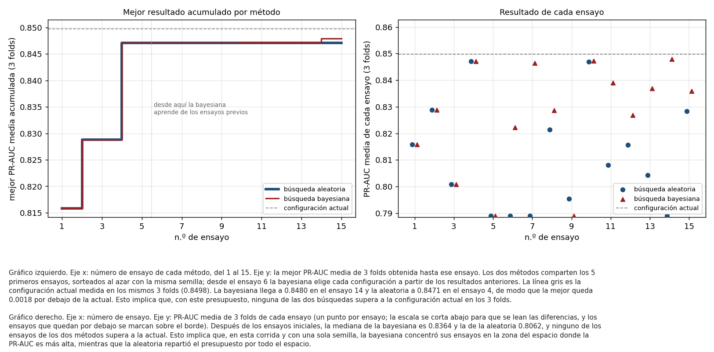

Fuente: elaboración propia a partir de [`reportes/hp_ensayos.csv`](reportes/hp_ensayos.csv).

En el gráfico izquierdo de la Figura 1, el eje x es el número de ensayo de cada método y el eje y la mejor PR-AUC obtenida hasta ese ensayo; en el derecho, el eje y es la PR-AUC de cada ensayo. Después de los 5 ensayos compartidos, la mediana de la bayesiana fue 0.8364 y la de la aleatoria 0.8062. Esa diferencia es coherente con que el TPE propuso C de al menos 0.1 en 9 de sus 10 ensayos propios, frente a 4 de 10 de la aleatoria, y evitó así la zona de C pequeño donde la PR-AUC cae. En esta corrida y con una sola semilla, la bayesiana aprovechó mejor el presupuesto, aunque su mejor resultado superó al de la aleatoria en solo 0.0009.

Figura 2. Efecto de cada hiperparámetro en la PR-AUC de la búsqueda

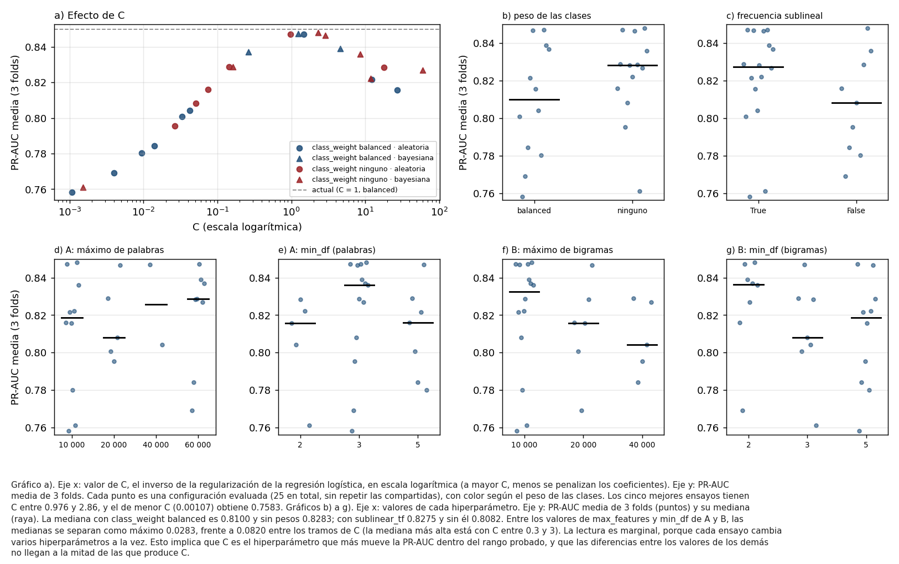

Fuente: elaboración propia a partir de [`reportes/hp_ensayos.csv`](reportes/hp_ensayos.csv).

En el panel a) de la Figura 2, el eje x es C en escala logarítmica y el eje y la PR-AUC de cada configuración; en los paneles b) a g), el eje x son los valores de cada hiperparámetro. La mediana de la PR-AUC pasa de 0.7651 con C hasta 0.01 a 0.8471 con C entre 0.3 y 3, y vuelve a bajar a 0.8268 con C mayor que 3. Los demás hiperparámetros separan bastante menos las medianas, y esas diferencias reflejan en parte los valores de C con los que coincidieron en cada ensayo. La configuración actual, con C de 1, ya está en el tramo de C con la PR-AUC más alta, lo cual es coherente con que la búsqueda no la haya superado.

### Confirmación con los 5 *folds* y regla
Tabla 3. PR-AUC por *fold* de la configuración actual y de la candidata (validación cruzada de 5 *folds*)

| *Fold* | Actual | Candidata | Diferencia |
|---|---|---|---|
| 1 | 0.8567 | 0.8567 | -0.00003 |
| 2 | 0.8527 | 0.8513 | -0.0014 |
| 3 | 0.8467 | 0.8435 | -0.0032 |
| 4 | 0.8542 | 0.8521 | -0.0021 |
| 5 | 0.8566 | 0.8562 | -0.0005 |
| Media | 0.8534 | 0.8519 | -0.0014 ± 0.0013 |

Fuente: elaboración propia a partir de [`reportes/hp_resultados.json`](reportes/hp_resultados.json).

Figura 3. Confirmación con los 5 *folds* del proyecto

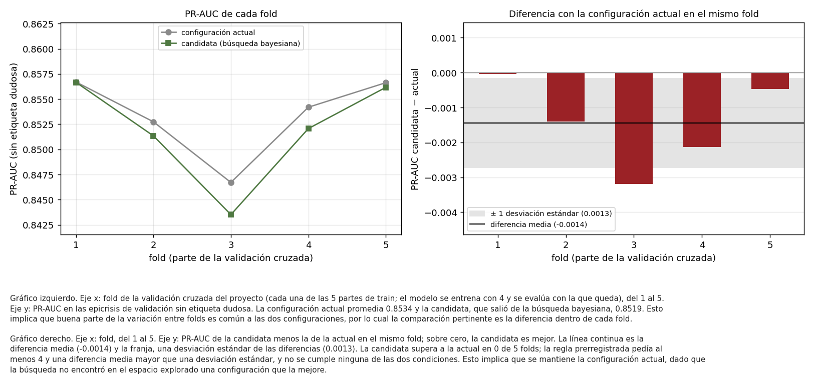

Fuente: elaboración propia a partir de [`reportes/hp_resultados.json`](reportes/hp_resultados.json).

Como se aprecia en la Tabla 3 y en la Figura 3, la candidata no superó a la configuración actual en ninguno de los 5 *folds*, con una diferencia media de -0.0014 y una desviación estándar de 0.0013. La mayor caída se dio en el *fold* 3 (-0.0032). Por consiguiente, no se cumple ninguna de las dos condiciones de la regla y se mantiene la configuración actual. La ROC-AUC media también fue menor con la candidata (0.8550 frente a 0.8582).

### *Test* (una sola medición)
Tabla 4. Medición única en *test* de la configuración actual y de la candidata

| Configuración | PR-AUC sin etiqueta dudosa | IC 95 % | PR-AUC con todas las epicrisis | ROC-AUC | Sensibilidad | Especificidad |
|---|---|---|---|---|---|---|
| Actual | 0.8671 | 0.8589–0.8749 | 0.8580 | 0.8706 | 0.7689 | 0.8038 |
| Candidata | 0.8645 | 0.8567–0.8719 | 0.8555 | 0.8666 | 0.7629 | 0.8035 |

Fuente: elaboración propia a partir de [`reportes/hp_resultados.json`](reportes/hp_resultados.json).

Como se aprecia en la Tabla 4, el *test* repite el orden de la validación cruzada, aunque los intervalos de confianza (remuestreando pacientes 200 veces) se solapan. Por ello, la decisión se apoya en la comparación por *fold*.

### Qué significan esos decimales en eventos adversos
Igual que en la semana 6, se aplicaron la sensibilidad y la especificidad de *test* (umbral 0.5) a 10 000 hospitalizaciones con epicrisis y la prevalencia real de 27.6 %, es decir, 2 759 con evento según los códigos.

Tabla 5. Eventos por cada 10 000 hospitalizaciones con epicrisis

| Configuración · epicrisis evaluadas | Eventos detectados (VP) | Eventos que se escapan (FN) | Falsas alarmas (FP) | De cada 100 alertas, con evento |
|---|---|---|---|---|
| Actual · sin etiqueta dudosa | 2 121 | 638 | 1 421 | 60 |
| Candidata · sin etiqueta dudosa | 2 105 | 654 | 1 423 | 60 |
| Actual · todas, etiqueta original | 1 983 | 776 | 1 484 | 57 |
| Candidata · todas, etiqueta original | 1 967 | 792 | 1 484 | 57 |

Fuente: elaboración propia a partir de [`reportes/hp_resultados.json`](reportes/hp_resultados.json).

Como se aprecia en la Tabla 5, la candidata detectaría 16 eventos menos por cada 10 000 hospitalizaciones, con 2 falsas alarmas más en las epicrisis sin etiqueta dudosa. El cálculo supone que las tasas de *test* valen para toda la base y que los eventos son los que marcan los códigos CIE, no una revisión clínica. Además, la diferencia está dentro de los intervalos de confianza, así que se toma solo como orden de magnitud.

### Tiempo de cómputo
El cómputo total fue de 110.3 minutos (1.8 horas en CPU). De ese total, 20.3 minutos fueron para contar palabras y bigramas en las 9 particiones (corrida previa con `--solo-conteos`) y 73.2 para la búsqueda. La confirmación tomó 13.3 minutos y el *test* 3.5, y los ensayos con C alto fueron los más lentos (hasta 8.5 minutos por ensayo).

### Decisión y siguiente paso
- Se mantiene la configuración actual, es decir, D2 con A+B+C, C 1 · A 20 000/3 · B 20 000/3 · balanced · sublinear_tf sí. Ninguna de las 25 configuraciones la superó en la búsqueda, y la candidata quedó por debajo en los 5 *folds* de la confirmación. La configuración actual ya se encuentra en la zona de mejor desempeño del espacio explorado.
- Aleatoria frente a bayesiana: en esta corrida y con una sola semilla, la bayesiana concentró mejor sus ensayos, pero su mejor resultado apenas superó al de la aleatoria (+0.0009). Con una sola repetición no se puede afirmar que un método sea mejor que el otro.
- Revisión ciega: como se mantiene la configuración actual, HE2 y HE3 se refieren a la misma configuración con la que se generó el lote.
- Siguiente experimento del Sprint 3: evaluar el modelo por servicio, grupo de edad y decil de largo frente al modelo de contexto, y recalibrar las probabilidades a la prevalencia real.

### Cómo reproducir la semana 7
- Requisitos: un archivo `.env` con las variables de `.env.example`, porque `cargar_config` (`src/utils.py`, líneas 27 a 31) se detiene si falta alguna. También se necesitan `data/processed/dataset.parquet`, las cachés `data/interim/dominio_hadm.parquet` y `data/interim/variantes_datos.parquet`, y `reportes/eda_resumen.json`, `reportes/datos_folds.csv` y `reportes/datos_resultados.json`. Si las dos cachés no existen, el script las rehace con `src/variables_dominio.py` y `src/variantes_datos.py`, que leen las tablas de MIMIC-IV de las rutas del `.env` y las etiquetas que deja la ingesta en `data/interim/`.
- Comandos de la corrida del 28-10-2026: primero `python src/experimentos_hp.py --solo-conteos`, que arma la caché de conteos, y después `python src/experimentos_hp.py`, que hace la búsqueda, la confirmación y el *test*. Un solo `python src/experimentos_hp.py` hace todo.
- Caché: el script guarda en `data/interim/cache_hp/`, fuera de git, los conteos y los resultados de cada evaluación, y una nueva corrida los reutiliza. Para repetir todo desde cero se borra esa carpeta.
- Control y figuras: `python src/experimentos_hp.py --prueba` corre una versión corta con el control de equivalencia y escribe sus salidas en `data/interim/prueba_hp/`. Las figuras se redibujan sin entrenar con `python src/figuras_hp.py`.
- Las cifras de esta sección salen de [`logs/metrics_hp.txt`](logs/metrics_hp.txt), [`reportes/hp_resultados.json`](reportes/hp_resultados.json) y [`reportes/hp_ensayos.csv`](reportes/hp_ensayos.csv).

Referencias: Bergstra, J. y Bengio, Y. (2012). Random search for hyper-parameter optimization. *Journal of Machine Learning Research, 13*, 281-305. Bergstra, J., Bardenet, R., Bengio, Y. y Kégl, B. (2011). Algorithms for hyper-parameter optimization. *Advances in Neural Information Processing Systems 24*. Falkner, S., Klein, A. y Hutter, F. (2018). BOHB: Robust and efficient hyperparameter optimization at scale. *ICML 2018*, PMLR 80. Las demás referencias están en el cuaderno.

### Importancia de variables (rama `sprint3-importancia-variables`)

El análisis completo está en el cuaderno [`notebooks/05_sprint3_semana7_importancia_variables.ipynb`](notebooks/05_sprint3_semana7_importancia_variables.ipynb). Se analizó el modelo vigente, es decir, D2 con A+B+C y la configuración que confirmó la búsqueda de hiperparámetros (C 1, 20 000 palabras y 20 000 bigramas con `min_df` de 3, *balanced* y `sublinear_tf`).

- Partición: solo los 5 *folds* del proyecto dentro de *train*, separados por paciente. No se usó el *test*, con el fin de no gastarlo y de no anticipar HE1.
- Sin estratos: no se calculó ninguna importancia ni ningún desempeño por servicio, edad o largo de la nota, comparación que corresponde a HE1 y se reserva para otro momento.
- Métodos: permutación por bloque (A, B y C, cada uno permutado en conjunto, 30 veces por *fold*), permutación de cada variable de contexto (con sus columnas *one-hot* juntas) y coeficientes de la regresión, con su estabilidad entre *folds*.
- Filtro de privacidad: se aplica antes de mostrar o guardar un término. Por criterio del autor, exige solo letras (sin dígitos ni el marcador ___), al menos 100 pacientes de *train* y ninguna palabra con mayúscula inicial en más del 50 % de sus apariciones. Además, exige el 1 % de las epicrisis de *train*, precedente del EDA de la semana 4 (`src/eda_texto.py`, línea 21, `MIN_DF = 0.01`).
- Control: en los 5 *folds*, la caché de conteos de la búsqueda de hiperparámetros dio matrices idénticas a las del *pipeline* de `src/features.py`, y la PR-AUC de cada *fold* reprodujo la de la semana 6 (diferencia máxima 0.000000).

Tabla 6. Caída de la PR-AUC al permutar cada bloque (media ± desviación estándar de 5 *folds*)

| Bloque | Caída de la PR-AUC | Por *fold* |
|---|---|---|
| A · palabras | 0.1274 ± 0.0028 | 0.1280, 0.1286, 0.1231, 0.1306, 0.1268 |
| B · bigramas | 0.0331 ± 0.0013 | 0.0336, 0.0310, 0.0332, 0.0346, 0.0330 |
| C · contexto | 0.1106 ± 0.0034 | 0.1106, 0.1148, 0.1075, 0.1070, 0.1133 |
| A+B · texto completo | 0.2349 ± 0.0046 | 0.2349, 0.2334, 0.2303, 0.2426, 0.2333 |

Fuente: elaboración propia a partir de [`reportes/importancia_resultados.json`](reportes/importancia_resultados.json).

Figura 4. Importancia por bloque y comparación con las semanas 5 y 6

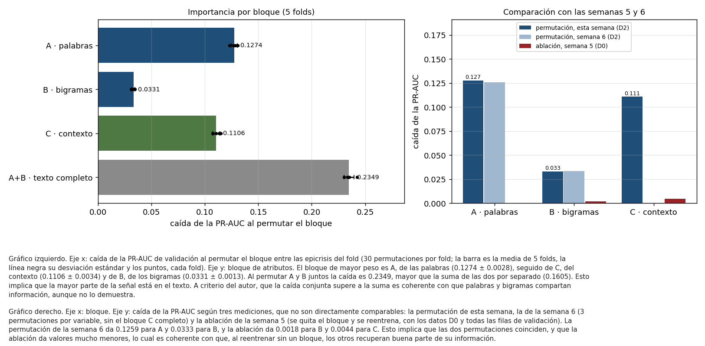

Fuente: elaboración propia a partir de [`reportes/importancia_resultados.json`](reportes/importancia_resultados.json).

Como se aprecia en la Tabla 6 y en la Figura 4, el bloque de mayor peso es el de las palabras (0.1274), seguido del contexto (0.1106) y de los bigramas (0.0331), en ese orden en los 5 *folds*. Al permutar juntas las palabras y los bigramas la caída es 0.2349, mayor que la suma de las dos por separado (0.1605). A criterio del autor, esto es coherente con que ambos bloques compartan información, aunque no lo demuestra. La permutación de esta semana coincide con la de la semana 6 (0.1259 y 0.0333). En cambio, la ablación de la semana 5, que reentrena sin el bloque, da caídas mucho menores (0.0018 para B y 0.0044 para C). La ablación mide cuánto pierde un modelo reentrenado sin el bloque, y no cuánto se apoya en él el modelo ya entrenado.

Tabla 7. Las seis variables de contexto de mayor peso (caída de la PR-AUC, media ± desviación estándar de 5 *folds*)

| Variable | Esta semana | Semana 6 |
|---|---|---|
| estancia (días) | 0.0132 ± 0.0014 | 0.0136 |
| servicio al ingreso | 0.0061 ± 0.0011 | 0.0061 |
| largo de la nota | 0.0054 ± 0.0002 | 0.0053 |
| servicio al alta | 0.0040 ± 0.0008 | 0.0044 |
| n.º de cultivos | 0.0038 ± 0.0008 | 0.0037 |
| destino al alta | 0.0037 ± 0.0009 | 0.0038 |

Fuente: elaboración propia a partir de [`reportes/importancia_resultados.json`](reportes/importancia_resultados.json) y [`reportes/datos_resultados.json`](reportes/datos_resultados.json).

Figura 5. Importancia de las variables de contexto

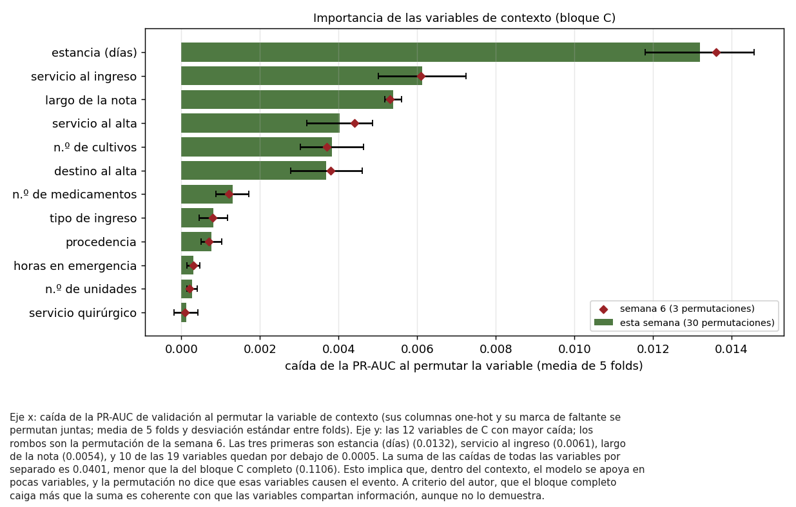

Fuente: elaboración propia a partir de [`reportes/importancia_resultados.json`](reportes/importancia_resultados.json).

Como se aprecia en la Tabla 7 y en la Figura 5, dentro del contexto pesan sobre todo estancia (días), servicio al ingreso y largo de la nota, mientras que 10 de las 19 variables quedan por debajo de 0.0005. La suma de las caídas por variable (0.0401) es menor que la del bloque completo (0.1106); a criterio del autor, esto es coherente con que las variables de contexto compartan información entre sí, aunque no lo demuestra.

Figura 6. Términos de mayor coeficiente que pasaron el filtro de privacidad

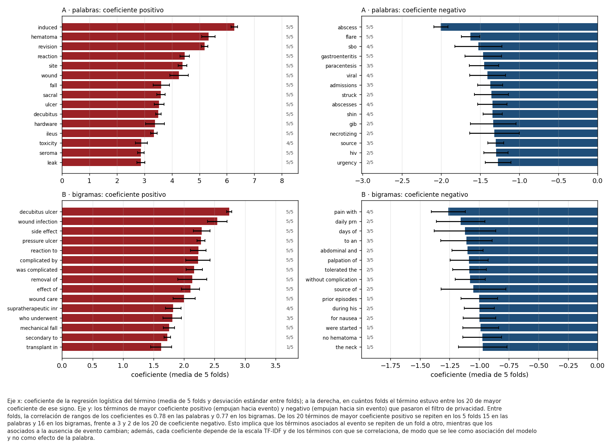

Fuente: elaboración propia a partir de [`reportes/importancia_terminos.csv`](reportes/importancia_terminos.csv).

Como se aprecia en la Figura 6, que muestra solo términos ya filtrados, entre *folds* la correlación de rangos de los coeficientes es 0.78 en las palabras y 0.77 en los bigramas. De los 20 términos de mayor coeficiente positivo se repiten en los 5 *folds* 15 palabras y 16 bigramas, frente a 3 y 2 del lado negativo. El filtro de privacidad excluyó 109 de 409 términos candidatos (45 por posible nombre propio, 36 por baja frecuencia y 33 por dígitos o símbolos), y se publican 60 términos ya filtrados.

A criterio del autor, los términos positivos (*induced*, *hematoma*, *revision*, *reaction*, *decubitus ulcer*, *wound infection*, y *fall* en el puesto 7 de las palabras) describen complicaciones de procedimientos, lesiones por presión, caídas y efectos adversos de medicamentos, las mismas familias de códigos de la etiqueta. Esta lectura es una interpretación y no un hallazgo. La importancia no es causalidad, los coeficientes de TF-IDF dependen de la escala y de la correlación entre términos, y, si los bloques comparten información, la permutación de cada uno por separado puede subestimar su peso.

#### Cómo reproducir la importancia de variables
- Requisitos: los mismos de la búsqueda de hiperparámetros (el `.env`, `data/processed/dataset.parquet` y las cachés de dominio y de variantes) y, además, la caché de conteos de `data/interim/cache_hp/`, que arma `python src/experimentos_hp.py --solo-conteos`. También lee `reportes/datos_folds.csv`, `reportes/datos_resultados.json`, `reportes/fe_resultados.json` y `reportes/hp_resultados.json`.
- Comando: `python src/importancia_variables.py`, con los parámetros de la sección `importancia` de `config/config.yaml`. La corrida del 28-10-2026 tomó 20.3 minutos en CPU, de modo que no fue necesario reducir las permutaciones. El modo `--prueba` corre 2 *folds* con 2 permutaciones, escribe en `data/interim/prueba_imp/` y deja su registro en [`logs/importancia_variables_prueba_20261028_123034.log`](logs/importancia_variables_prueba_20261028_123034.log), con el control de la caché y de la PR-AUC por *fold*. Una primera corrida de prueba falló al final por un choque de nombres de variable, que se corrigió antes de la corrida completa; su registro no se conservó.
- Las figuras se redibujan sin entrenar con `python src/figuras_imp.py`. Las cifras salen de [`logs/metrics_importancia.txt`](logs/metrics_importancia.txt), [`reportes/importancia_resultados.json`](reportes/importancia_resultados.json), [`reportes/importancia_grupos.csv`](reportes/importancia_grupos.csv) y [`reportes/importancia_terminos.csv`](reportes/importancia_terminos.csv).

---

## 📌 Roadmap
Las tareas, con responsable y plazo, están en los [issues](https://github.com/carlosperez100/mia14-trabajo-investigacion-ii-tesis-gemses-mimic/issues) y [milestones](https://github.com/carlosperez100/mia14-trabajo-investigacion-ii-tesis-gemses-mimic/milestones).
- [x] Semana 1 → Diagnóstico, estructura del repositorio y plan del Sprint 1.
- [x] Semana 2 → Ingesta + preprocesamiento + logging (entregable de diseño del pipeline: 18/20).
- [x] Semana 3 → EDA + baseline + demo interna (entregable del repositorio: 20/20).
- [x] Semana 4 → EDA reproducible con log automático (`src/eda.py`) en la rama `sprint1-eda`: variables de la hospitalización, texto y eventos del Anexo 02.
- [x] Semana 5 → Feature engineering en la rama `sprint2-feature-engineering`: ablación A, A+B, A+C y A+B+C con validación cruzada por paciente; se adopta A+B+C (PR-AUC 0.8732 en validación cruzada y 0.8830 en test).
- [x] Semana 6 → Cierre del Sprint 2: variantes de los datos (D0, D1, D2) y diagnósticos; se adopta D2 con A+B+C (PR-AUC 0.8534 frente a 0.8431 de D0 en validación cruzada, sobre las mismas filas).
- [x] Semana 7 → Sprint 3, búsqueda de hiperparámetros aleatoria y bayesiana (Optuna) en la rama `sprint3-hiperparametros`: ninguna configuración supera a la actual y, por la regla prerregistrada, se mantiene D2 con A+B+C (PR-AUC 0.8534 en validación cruzada y 0.8671 en test).
- [x] Semana 7 → importancia de variables en la rama `sprint3-importancia-variables`, con los 5 folds de train y sin test: palabras 0.1274, contexto 0.1106 y bigramas 0.0331 de caída de la PR-AUC al permutar cada bloque.
- [ ] Sprint 3 → Evaluación por servicio, grupo de edad y decil de largo frente al modelo de contexto, recalibración a la prevalencia de 27.6 % y explicación de logística frente a LinearSVC.

---

## 📜 Licencia
Uso académico – Universidad Nacional de Ingeniería (UNI). Los datos de MIMIC-IV se rigen por el acuerdo de uso (DUA) de PhysioNet y no forman parte de este repositorio.
